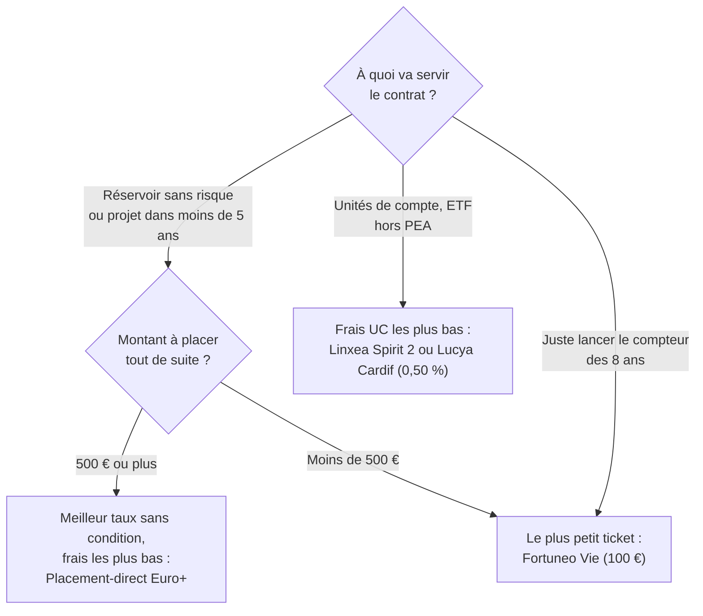

Ce tuto sert à décider **si** ouvrir une assurance vie, **quel contrat** choisir et **comment** s'en servir jusqu'au retrait. Comme pour le [tuto PEA](../ouvrir_un_pea/), les offres changent chaque année : la partie 5 donne une photo au **24 octobre 2026**, et la partie 8 explique comment refaire l'analyse soi-même.

Les chiffres de marché viennent du rapport public de l'ACPR (le superviseur des assureurs) sur la revalorisation 2025. Les conditions des contrats viennent des pages et documents publiés par les distributeurs eux-mêmes, pas des comparateurs en ligne, souvent rémunérés par affiliation.

 

## 1. L'assurance vie en bref

Comme le PEA, l'assurance vie n'est pas un placement mais une **enveloppe**. On y choisit entre deux types de supports :

| **Support** | **Ce que c'est** | **Risque** |
|:--|:--|:--|
| **Fonds en euros** | L'assureur garantit le capital et verse un intérêt chaque année, acquis définitivement | Capital garanti, diminué des frais de gestion annuels (voir partie 3) |
| **Unités de compte (UC)** | Des fonds non garantis : ETF, fonds actions, obligations, immobilier… | Le capital peut baisser |

| **Point** | **Règle** |
|:--|:--|
| Nombre de contrats | Illimité, chez un ou plusieurs assureurs |
| Plafond | Aucun |
| Disponibilité | L'argent reste disponible à tout moment (rachat partiel ou total), contrairement à une idée reçue |
| Prélèvements sociaux | **17,2 %** des gains, l'assurance vie étant exclue de la hausse de la CSG de 2026 (18,6 % pour le PEA) |
| Impôt avant 8 ans | 12,8 % des gains retirés (ou barème de l'impôt sur le revenu, sur option) |
| Impôt après 8 ans | Abattement annuel de **4 600 €** de gains (9 200 € pour un couple), **pour l'ensemble des contrats** (voir l'encadré ci-dessous), puis 7,5 % au-delà (12,8 % pour la part des versements dépassant 150 000 €) |
| Transmission | Hors succession : jusqu'à 152 500 € par bénéficiaire sans droits pour les versements faits avant 70 ans |

Le compteur des 8 ans part du **premier versement sur chaque contrat**. Ouvrir tôt un contrat avec une petite somme fait donc gagner des années.

> **⚠️ L'abattement est global, pour tous les contrats.** Il est accordé **une seule fois par an et par foyer fiscal**, tous contrats confondus : avoir plusieurs contrats ne le multiplie pas (trois contrats de plus de 8 ans donnent toujours 4 600 € au total, pas 13 800 €). Seuls les contrats ayant **8 ans ou plus** y donnent droit, et la part non utilisée une année **ne se reporte pas** sur la suivante.
>
> Texte de loi : « […] à huit ans pour les bons ou contrats souscrits à compter du 1er janvier 1990, il est opéré, *pour l'ensemble des bons ou contrats détenus par un même contribuable*, un abattement annuel de 4 600 € pour les contribuables célibataires, veufs ou divorcés et de 9 200 € pour les contribuables mariés soumis à imposition commune […] » ([article 125-0 A du Code général des impôts, I, 1°](https://www.legifrance.gouv.fr/codes/article_lc/LEGIARTI000044989424), version consolidée sur Légifrance, dernière modification par la loi n° 2021-1900 du 30 décembre 2021). Absence de report : [BOFiP, BOI-RPPM-RCM-20-10-20-50](https://bofip.impots.gouv.fr/bofip/3951-PGP.html/identifiant%3DBOI-RPPM-RCM-20-10-20-50-20191220).
>
> **Ordre d'application :** l'abattement s'applique en priorité aux gains issus des versements faits **avant le 27 septembre 2017**, puis à ceux des versements postérieurs (même article, cinquième alinéa du I, 1°). Pour un contrat ouvert après cette date, tous les versements sont concernés de la même façon.

 

## 2. À quoi sert une assurance vie, à côté du PEA ?

| **Besoin** | **Meilleure enveloppe** | **Pourquoi** |
|:--|:--|:--|
| Épargne de précaution | Livret A, LDDS | Disponibles immédiatement, sans impôt, sans frais |
| Argent sans risque au-delà des plafonds des livrets (22 950 € + 12 000 €) | **Fonds en euros** de l'assurance vie | Capital garanti, rendement en général supérieur au Livret A, disponible en quelques jours |
| Mettre à l'abri l'argent d'un projet dans 1 à 5 ans (apport immobilier…) | **Fonds en euros** | Les actions ont environ 30 % de risque de perte sur 5 ans (Anarkulova, Cederburg et O'Doherty, *Journal of Financial Economics*, 2022) |
| Actions sur le long terme | **PEA** d'abord | Pas de frais d'enveloppe (0,5 à 0,75 %/an en assurance vie sur les UC), fiscalité au bout de 5 ans au lieu de 8 |
| Placements hors Europe, obligations, au-delà de 150 000 € | Assurance vie en UC | Le PEA ne les permet pas |
| Transmettre un capital | Assurance vie | Régime successoral spécifique |

Pour la plupart des gens, l'assurance vie sert donc d'abord de **réservoir sans risque**, en complément des livrets, et le PEA de moteur à long terme.

 

## 3. Analyser sa situation

| **Question** | **Pourquoi c'est important** |
|:--|:--|
| Vais-je surtout utiliser le **fonds en euros** ou des **UC** ? | Les meilleurs contrats ne sont pas les mêmes : rendement du fonds en euros dans un cas, frais sur les UC et choix d'ETF dans l'autre. |
| Puis-je mettre **100 % sur le fonds en euros** ? | Beaucoup de contrats l'interdisent ou le limitent : obligation de placer 30 % en UC, plafond à 25 % (Corum Life), plafond en euros. |
| Le taux affiché dépend-il d'un **bonus** ? | D'après l'ACPR, les bonus liés à la part d'UC sont souvent de +1 point, jusqu'à plus de +2 points. Sans bonus, on touche au moins 0,39 point de moins que la moyenne du marché. |
| Combien puis-je **perdre au pire** par an ? | Dans les fonds en euros récents, le capital garanti est égal aux sommes versées **diminuées des frais de gestion**, prélevés chaque année après les intérêts. Si l'assureur ne verse rien, on perd donc ces frais : 0,60 %/an chez SwissLife (Placement-direct Euro+), 2 %/an chez Spirica (Linxea Spirit 2), jusqu'à 3 %/an chez Suravenir (Opportunités 2). Le chiffre exact figure dans le tableau des **valeurs minimales garanties** de la notice. Pour de l'argent qui ne doit pas bouger, préférer les frais les plus bas. |
| Combien puis-je verser à l'**ouverture** ? | De 100 € à 500 € selon les contrats. |
| Quels **frais** ? | En ligne : 0 % sur les versements et les arbitrages ; 0,5 à 0,77 %/an sur le fonds en euros (déjà déduits du taux affiché) et sur les UC. En agence, les frais d'entrée vont souvent de 2 à 5 %. |

 

## 4. Ce que disent les données publiques

Rapport de l'ACPR sur la revalorisation 2025 (juin 2026) :

- **Taux moyen des fonds en euros : 2,63 %** net de frais de gestion, avant prélèvements sociaux, comme en 2024. Pour mémoire, le Livret A était à 2,2 % en moyenne en 2025.
- **Grande dispersion :** la moitié des encours est chez des assureurs qui ont servi entre 2,3 % et 2,9 %.
- **La moyenne inclut les bonus.** Ces bonus sont souvent accordés en échange d'une part d'UC. Sans aucun bonus, on touche au moins 0,39 point de moins que la moyenne.
- **Frais de gestion moyens du fonds en euros : 0,63 %/an.**
- **Les unités de compte ont rapporté environ 2 %/an en moyenne depuis 2020, une fois déduits les frais des fonds et du contrat.** C'est la conséquence des frais élevés de beaucoup de fonds (AMF : 1,37 %/an en moyenne pour les fonds actions actifs, contre 0,33 % pour les ETF), et un argument de plus pour choisir des ETF quand on prend des UC.

 

## 5. Les contrats au 24 octobre 2026

Contrats en ligne en gestion libre, sans frais sur les versements ni sur les arbitrages. Rendements 2025 nets de frais de gestion, avant prélèvements sociaux.

| **Contrat** (assureur) | **Fonds en euros 2025** | **Accès 100 % fonds en euros** | **Frais fonds en euros** | **Frais UC** | **Versement d'ouverture** |
|:--|:--:|:--:|:--:|:--:|:--:|
| Placement-direct Euro+ (SwissLife) | **3,60 %** | Oui, jusqu'à 200 000 € (depuis le 03/08/2026) | 0,60 % (perte maximale 0,60 %/an, notice) | non relevé | 500 € (notice) |
| Meilleurtaux Essentiel Vie (La France Mutualiste) | **3,50 %** (+1,50 % de bonus 2026 si 30 % d'UC) | Oui | 0,77 % | 0,50 % (ETF : 0,60 %) | 300 à 500 € (pages divergentes) |
| Linxea Spirit 2 (Spirica), fonds Nouvelle Génération | 3,08 % | Oui, sans condition | **2 %** (perte maximale 2 %/an) | **0,50 %** | 500 € |
| BoursoBank Vie (Generali), fonds Euro Exclusif | 3,00 % (bonus sur versements en 2025) | Non vérifié | 0,75 % | 0,75 % | 300 € |
| Altaprofits Vie (Generali), fonds Netissima | 3,00 % | Non vérifié | 0,75 % | 0,45 à 0,60 % | 300 € |
| Linxea Avenir 2+ (Suravenir), Opportunités 2 | 3,00 % (si moins de 30 % d'UC) | Oui | 0,60 %, jusqu'à 3 % en cas de crise | 0,60 % | non relevé |
| Fortuneo Vie (Suravenir), Opportunités 2 | 3,00 % (si moins de 30 % d'UC, jusqu'à 4,5 % au-delà de 70 %) | Oui, en gestion libre actuellement | 0,60 %, jusqu'à 3 % en cas de crise | 0,75 % | **100 €** |
| Lucya Cardif (BNP Paribas Cardif), fonds général | 2,75 % | Oui | 0,70 % | **0,50 %** | 500 € |
| Corum Life (Corum) | 4,10 % | **Non, 25 % maximum** | 0,60 % | non relevé | 50 € |

**Gestion pilotée** (on délègue les choix) : Yomoni, Nalo, Ramify… avec en général 1 à 1,65 %/an de frais au total. Voir le [tuto PEA](../ouvrir_un_pea/), partie 5, pour le coût de la délégation.

 

## 6. Que choisir aujourd'hui

**À retenir :**

- **Pour un réservoir sans risque**, viser un fonds en euros **accessible à 100 % sans condition d'UC**, avec les **frais de gestion les plus bas** (ce sont eux qui fixent la perte maximale par an). Au 24/10/2026, Placement-direct Euro+ cumule le meilleur taux 2025 sans condition (3,60 %) et l'accès à 100 % jusqu'à 200 000 €.
- **Se méfier des taux les plus hauts** : ils supposent souvent des UC (bonus) ou un plafond (Corum Life, 25 % maximum en fonds en euros).
- **Le rendement passé d'un fonds en euros n'est pas garanti pour la suite.** Les écarts entre bons contrats sont de quelques dixièmes de point par an. La garantie, l'accès sans condition et les frais comptent davantage.
- **On peut avoir plusieurs contrats.** Ouvrir un petit contrat aujourd'hui pour lancer le compteur des 8 ans n'empêche pas d'en ouvrir un meilleur plus tard.

 

## 7. Le jour du retrait

| **Situation** | **Ce qui se passe** |
|:--|:--|
| Retrait partiel | Le contrat reste ouvert. Chaque retrait contient une part de versements (non imposée) et une part de gains (imposée). |
| Avant 8 ans | Gains : 12,8 % d'impôt + 17,2 % de prélèvements sociaux |
| Après 8 ans | Gains : 17,2 % de prélèvements sociaux ; impôt seulement au-delà de 4 600 € de gains retirés par an (9 200 € pour un couple), à 7,5 % |
| Délai | En général quelques jours ; l'assureur a légalement jusqu'à 2 mois |
| Crise financière grave | La loi Sapin 2 permet au Haut Conseil de stabilité financière de limiter temporairement les retraits (3 mois renouvelables une fois). Ce pouvoir n'a jamais été utilisé. C'est une raison de garder l'épargne de précaution sur des livrets, pas en assurance vie. |

**Astuce après 8 ans :** retirer chaque année jusqu'à 4 600 € de **gains** sans impôt, puis reverser si l'argent n'est pas utilisé, « purge » l'impôt futur sur ces gains (les prélèvements sociaux restent dus).

 

## 8. Refaire l'analyse quand les offres changent

1. **Chaque début d'année**, les assureurs annoncent le rendement de l'année passée : relever le taux du fonds en euros **sans bonus** et ses **conditions** (part d'UC exigée, plafond).
2. **Vérifier dans la notice d'information** (document contractuel, pas la page commerciale) : frais de gestion du fonds en euros, garantie du capital (presque toujours diminuée des frais de gestion), tableau des valeurs minimales garanties, frais pouvant être relevés en cas de crise.
3. **Comparer au rapport annuel de l'ACPR** (publié vers juin) : un contrat durablement sous la moyenne sans raison mérite d'être reconsidéré.
4. **Ne pas clôturer un vieux contrat** pour en ouvrir un nouveau : on perdrait l'ancienneté fiscale. Mieux vaut cesser de l'alimenter et verser sur le nouveau.
5. **Ignorer les bonus temporaires** qui exigent des UC qu'on ne voulait pas.

 

## 9. Ouvrir son assurance vie, étape par étape

1. Définir l'usage (partie 2) et répondre aux questions de la partie 3.
2. Choisir le contrat (parties 5 et 6), puis lire sa **notice d'information** avant de signer.
3. Souscrire en ligne : pièce d'identité, justificatif de domicile, RIB, et la **clause bénéficiaire** (qui touche le capital en cas de décès ; la formule standard « mon conjoint, à défaut mes enfants, à défaut mes héritiers » convient à beaucoup de situations).
4. Faire le premier versement pour lancer le compteur des 8 ans.
5. Revoir chaque année le rendement du fonds en euros (partie 8).

 

## Sources

**Organismes publics**
- ACPR, [Revalorisation 2025 des contrats d'assurance vie et de capitalisation](https://acpr.banque-france.fr/system/files/2026-06/20260630_AS180_revalorisation_2025.pdf), juin 2026.
- AMF, [Lettre de l'Observatoire de l'épargne n°65](https://www.amf-france.org/sites/institutionnel/files/private/2026-04/loe-65_1.pdf) (frais des ETF et des fonds actifs).
- Article L. 631-2-1 du Code monétaire et financier (loi Sapin 2), expliqué par [Toutsurmesfinances](https://www.toutsurmesfinances.com/placements/assurance-vie-et-loi-sapin-2-principe-changements-et-entree-en-vigueur.html).

**Étude universitaire**
- Anarkulova, Cederburg et O'Doherty (2022), *Stocks for the long run? Evidence from a broad sample of developed markets*, Journal of Financial Economics ([présentation](https://corpgov.law.harvard.edu/2021/12/13/stocks-for-the-long-run-evidence-from-a-broad-sample-of-developed-markets)).

**Textes officiels**
- [Article 125-0 A du Code général des impôts](https://www.legifrance.gouv.fr/codes/article_lc/LEGIARTI000044989424) (Légifrance) : abattement global de 4 600 € / 9 200 €, durée de 8 ans, ordre d'application, transformation de contrat chez le même assureur.
- [BOFiP, BOI-RPPM-RCM-20-10-20-50](https://bofip.impots.gouv.fr/bofip/3951-PGP.html/identifiant%3DBOI-RPPM-RCM-20-10-20-50-20191220) : abattement accordé une fois par an, sans report.

**Fiscalité** (sources secondaires, à recouper avec impots.gouv.fr)
- [Linxea, fiscalité de l'assurance vie](https://www.linxea.com/tout-savoir-sur/assurance-vie/fiscalite-assurance-vie-regles-abattements-et-strategies/)
- [Assurance vie et prélèvements sociaux 2026 : 17,2 %](https://www.combattrelacrise.fr/assurance-vie-2026-fiscalite/)

**Pages et documents des contrats, consultés le 24/10/2026**
- Placement-direct : [Euro+](https://www.placement-direct.fr/assurance-vie/placement-direct-euro-plus), [retour du 100 % fonds en euros](https://www.placement-direct.fr/actualites/placement-direct-euro-retour-du-100percent-fonds-en-euros-jusqua-200-000-euro), [notice](https://static.placement-direct.fr/documents/notice-du-contrat-placement-direct-euro.pdf)
- [Meilleurtaux Essentiel Vie](https://placement.meilleurtaux.com/assurance-vie/meilleure-assurance-vie/meilleurtaux-essentiel-vie.html)
- Linxea : [fonds en euros de Linxea Spirit 2](https://www.linxea.com/assurance-vie/linxea-spirit-2/supports-disponibles-sur-linxea-spirit-2/fonds-euro/), [Linxea Avenir 2+](https://www.linxea.com/assurance-vie/linxea-avenir-2/)
- [BoursoBank Vie, rendements 2025](https://www.boursobank.com/aide-en-ligne/assurance-vie/comment-fonctionne-l-assurance-vie/performances-et-frais-de-gestion/question/quels-sont-les-taux-de-rendement-des-fonds-euros-et-les-differents-boosts-sur-mon-contrat-d-assurance-vie-pour-l-annee-2025-70295862)
- [Altaprofits Vie](https://www.altaprofits.com/assurance-vie/altaprofits-vie/frais-reduits)
- Fortuneo : [frais de Fortuneo Vie](https://www.fortuneo.fr/faq/quels-sont-les-frais-du-contrat-fortuneo-vie), [Suravenir Opportunités 2](https://www.fortuneo.fr/assurance-vie/fonds-euros-opportunites-2)
- [Lucya Cardif, fonds en euros](https://www.assurancevie.com/nos-contrats/assurance-vie/lucya-cardif/zoom-sur-les-fonds-en-euros-de-cardif.html)
- [Corum, performances 2025](https://infos.corum.fr/performances-2025/)
