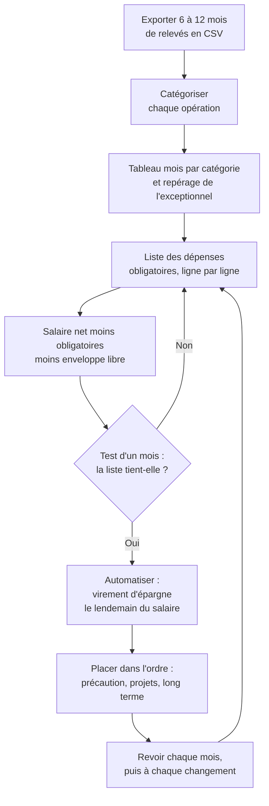
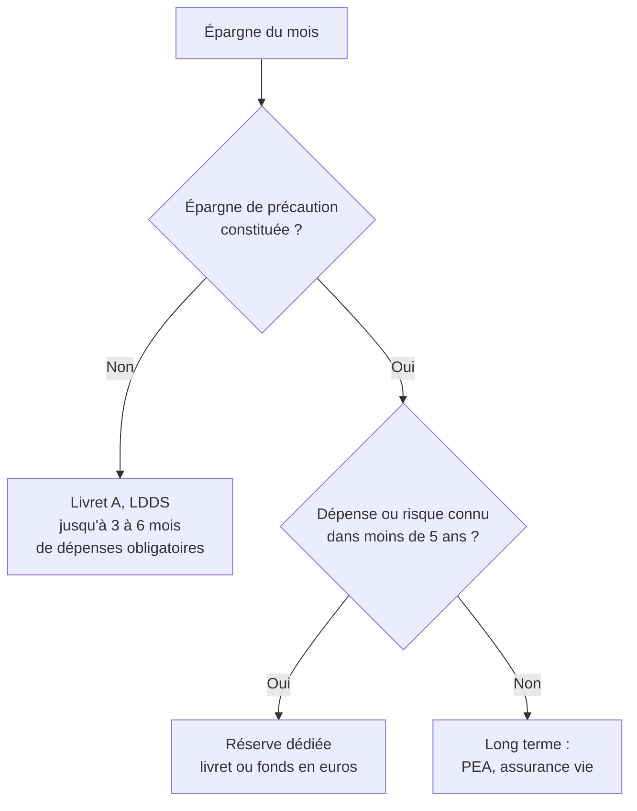

Ce tuto sert à répondre à une question simple : **combien puis-je mettre de côté chaque mois, sans craquer au bout de trois mois ?** La méthode part des relevés bancaires réels, pas des souvenirs : on y retrouve ce qu'on dépense vraiment, on sépare ce qui est obligatoire de ce qui ne l'est pas, puis on en déduit un montant d'épargne tenable et on l'automatise.

Elle ne demande ni logiciel payant ni application de gestion : un tableur suffit. Il faut compter quelques heures la première fois, puis une demi-heure par mois.

Les recommandations s'appuient sur des études universitaires publiées dans des revues à comité de lecture et sur des organismes publics (Insee, Banque de France). Les exemples chiffrés sont **fictifs**.

 

## 1. La méthode en un coup d'œil

Pourquoi partir des relevés : la plupart des dépenses ne sont pas renégociables à court terme. D'après l'Insee, les **dépenses dites « pré-engagées »** (logement, énergie, eau, télécommunications, assurances, services bancaires, cantine) représentent **30,3 % du revenu disponible** des ménages en 2024, dont près de 23 points pour le seul logement. C'est une moyenne nationale : la part de chacun peut être très différente, et seuls ses propres relevés la donnent.

 

## 2. Exporter ses relevés

1. **Où les trouver.** Dans l'espace client de la banque en ligne (site web plutôt qu'application, qui propose souvent moins d'options), la rubrique s'appelle en général « Historique des opérations », « Mes comptes » puis « Télécharger » ou « Exporter ».
2. **Quelle période.** Au moins **6 mois**, idéalement **12** : sur une année complète, on voit passer les dépenses annuelles (assurances, taxe, abonnements) et saisonnières (chauffage, vacances, cadeaux de fin d'année). Certaines banques limitent l'export à quelques mois par fichier : faire plusieurs exports et les mettre bout à bout.
3. **Quel format.**

| **Format** | **Usage** |
|:--|:--|
| **CSV** | Le plus pratique : s'ouvre dans n'importe quel tableur. Vérifier l'encodage (accents mal affichés) et le séparateur (souvent `;` en France, avec la virgule comme séparateur décimal) |
| **OFX / QIF** | Pour les logiciels de comptabilité personnelle |
| **PDF** | À éviter pour l'analyse : il faut tout ressaisir |

4. **Confidentialité.** Avant de partager le fichier (avec un proche, un conseiller, un outil en ligne), **supprimer l'IBAN, les numéros de compte et de carte**, et regarder les libellés : on y trouve parfois des noms de personnes ou des références de dossier. Garder l'original chez soi, ne partager qu'une copie nettoyée.

 

## 3. Catégoriser chaque opération

On ajoute une colonne « Catégorie » à côté de chaque ligne. Dans un tableur, une formule qui cherche un mot dans le libellé (par exemple `SI(ESTNUM(CHERCHE("EDF";B2));"Énergie";…)`) ou un petit script avec une liste de règles fait l'essentiel du travail. Le reste se fait à la main.

### Une liste de catégories qui fonctionne

| **Catégorie** | **Exemples** |
|:--|:--|
| Logement | Loyer, charges, crédit immobilier |
| Énergie et eau | Électricité, gaz, fioul, eau |
| Assurances | Habitation, auto, prévoyance |
| Télécom | Box internet, forfait mobile |
| Abonnements | Streaming, presse, salle de sport, logiciels |
| Courses | Supermarché, drive, marché |
| Carburant | Stations-service, pompes de supermarché |
| Transports | Train, bus, péage, parking, entretien du véhicule |
| Restaurants | Restaurants, livraison de repas, cafés |
| Achats en ligne | Sites marchands |
| Loisirs | Sorties, voyages, culture, sport ponctuel |
| Santé | Pharmacie, consultations (part non remboursée) |
| Revenus | Salaire, remboursements, aides |
| Virements internes | Vers ses propres livrets ou comptes |
| Exceptionnel | Déménagement, gros achat, dette remboursée |

### Les pièges rencontrés en pratique

- **Le carburant déguisé en courses.** Les pompes automatiques des supermarchés apparaissent sous le nom du supermarché, parfois avec une mention courte (« DAC », « VL », « carburant ») et un montant rond, du type 40,01 € ou 60,00 €. Ce n'est pas un plein de courses mais un plein d'essence.
- **Le libellé qui trompe.** Un libellé peut cacher autre chose que ce qu'il annonce : un fournisseur internet facturé sous un nom qui évoque un parking, une location de camion payée à l'accueil d'un supermarché. Quand on n'est pas sûr, **ne pas deviner** : chercher le libellé exact, retrouver la facture, ou demander à la personne concernée.
- **Les opérations qui s'annulent.** Un dépôt de garantie reçu puis reversé, un achat remboursé, une avance faite pour quelqu'un puis rendue : les classer ensemble et les **neutraliser**, sinon elles gonflent à la fois les revenus et les dépenses.
- **Les virements vers ses propres comptes.** Un virement vers son livret n'est pas une dépense, c'est de l'épargne. Le classer à part.
- **Ce qui n'apparaît pas.** Les dépenses payées en espèces (laverie en pièces, marché, pourboires) ou depuis un autre compte (compte joint, carte d'un conjoint) ne figurent pas sur le relevé. Les **ajouter à la main**, sinon le budget sera trop optimiste.

 

## 4. Faire le tableau mois par catégorie

Un tableau croisé dynamique (catégories en lignes, mois en colonnes, somme des montants) donne en quelques clics la vue d'ensemble.

Ce qu'il faut y chercher :

- **Les ruptures.** Comparer des périodes séparées par un changement de vie (déménagement, nouvel emploi, achat d'une voiture) : seuls les mois qui ressemblent à la situation actuelle comptent pour la suite.
- **L'exceptionnel.** Un mois à 3 000 € de dépenses à cause d'un déménagement, d'une dette remboursée ou d'un gros achat ne doit pas être pris pour du récurrent. Le reclasser en « Exceptionnel » et l'exclure des moyennes.
- **Les moyennes utiles.** La moyenne des 3 derniers mois « normaux » est souvent plus parlante que la moyenne sur un an, si la situation a changé entre-temps.

 

## 5. Construire la liste des dépenses obligatoires

C'est le cœur de la méthode. Une dépense obligatoire est une dépense qu'on ne peut pas arrêter le mois prochain sans conséquence sérieuse. On construit la liste **ligne par ligne**, en partant des **montants réels des relevés**.

| **Type de dépense** | **Comment l'obtenir** | **Exemple** |
|:--|:--|:--|
| Charges fixes mensuelles | Montant du dernier prélèvement | Loyer, énergie, eau, box, mobile, abonnements jugés indispensables |
| Dépenses hebdomadaires | Montant par semaine **× 4,33** (52 semaines ÷ 12 mois) | 70 € de courses par semaine = 303 € par mois |
| Dépenses trimestrielles, semestrielles ou annuelles | Montant **÷ nombre de mois couverts** | Assurance auto à 135 € par trimestre = 45 € par mois |
| Carburant | **km par mois × consommation × prix du litre**, puis comparer aux relevés | 800 km × 6 L/100 km × 1,80 €/L = 86 € par mois |
| Prélevé sur la fiche de paie | **Ne pas compter** : déjà déduit du salaire net | Mutuelle d'entreprise, impôt à la source |
| Tout le reste | Classé **« retirable »** | Restaurants, achats en ligne, loisirs, abonnements non indispensables |

Pourquoi multiplier par 4,33 et non par 4 : un mois compte en moyenne 4,33 semaines. Multiplier par 4 oublie environ quatre semaines par an, soit un mois de courses entier.

**Trois règles :**

1. **C'est la personne concernée qui valide chaque ligne.** Ce qui est indispensable pour l'un (une voiture, un abonnement de transport, un forfait sport prescrit) ne l'est pas pour l'autre. Personne d'autre ne peut trancher.
2. **Chaque ligne est vérifiée contre les relevés.** Les erreurs typiques : oublier l'assurance (prélevée une fois par an), sous-estimer une dépense en espèces (laverie), oublier un abonnement pourtant jugé indispensable, prendre le montant d'il y a deux ans au lieu du tarif actuel.
3. **Une ligne retirable n'est pas interdite.** Elle sera financée par l'enveloppe libre (partie 6), pas par la liste des obligatoires.

### Modèle à recopier (exemple fictif)

| **Poste** | **Fréquence** | **Montant réel** | **Calcul** | **Par mois** | **Validé** |
|:--|:--|--:|:--|--:|:--:|
| Loyer et charges | Mensuel | 700 € | | 700 € | ☐ |
| Électricité, gaz | Mensuel | 70 € | | 70 € | ☐ |
| Eau | Semestriel | 150 € | ÷ 6 | 25 € | ☐ |
| Assurance habitation | Annuel | 180 € | ÷ 12 | 15 € | ☐ |
| Assurance auto | Trimestriel | 135 € | ÷ 3 | 45 € | ☐ |
| Box internet | Mensuel | 30 € | | 30 € | ☐ |
| Forfait mobile | Mensuel | 10 € | | 10 € | ☐ |
| Courses | Hebdomadaire | 70 € | × 4,33 | 303 € | ☐ |
| Carburant | Selon km | 800 km/mois | × 6 L/100 × 1,80 € | 86 € | ☐ |
| Entretien du véhicule | Annuel | 360 € | ÷ 12 | 30 € | ☐ |
| Abonnement indispensable | Annuel | 60 € | ÷ 12 | 5 € | ☐ |
| Santé (reste à charge) | Variable | 20 € | moyenne | 20 € | ☐ |
| **Total** | | | | **1 339 €** | |

Pour son propre tableau, effacer les montants et partir de ses relevés.

 

## 6. Calculer sa capacité d'épargne

Deux calculs, dans cet ordre :

| **Calcul** | **Formule** | **Exemple fictif** |
|:--|:--|--:|
| Épargne maximale (« mode strict ») | Salaire net − dépenses obligatoires | 2 400 − 1 339 = **1 061 €** |
| Épargne tenable | Épargne maximale − enveloppe libre | 1 061 − 300 = **761 €** |

**Exemple fictif :** Camille gagne 2 400 € nets par mois. Sa liste validée d'obligatoires fait 1 339 € (tableau ci-dessus). En mode strict, elle pourrait épargner 1 061 € par mois. Elle garde 300 € d'enveloppe libre et programme donc **environ 760 €** d'épargne mensuelle.

### Pourquoi le mode strict n'est pas tenable

Vivre douze mois de suite avec les seules dépenses obligatoires, c'est zéro sortie, zéro cadeau, zéro imprévu. Au premier anniversaire ou à la première panne, on pioche dans l'épargne, et le plan s'effondre. L'**enveloppe libre** (souvent 250 à 300 € par mois pour une personne seule, à ajuster) sert à financer :

- les loisirs, sorties et restaurants ;
- les cadeaux et fêtes ;
- les petits imprévus qui ne justifient pas de toucher à l'épargne de précaution ;
- tout ce qui a été classé « retirable » mais qu'on ne veut pas supprimer.

Séparer l'argent en enveloppes étiquetées n'a rien d'une astuce de grand-mère : c'est ce que les économistes appellent la **comptabilité mentale**. Les gens traitent différemment l'argent selon le « compte » auquel ils l'ont attribué, même si un euro reste un euro (Thaler, *Journal of Behavioral Decision Making*, 1999). Ce biais est un défaut quand il pousse à dépenser une prime « tombée du ciel », mais il devient un outil quand on s'en sert pour protéger l'épargne : l'argent rangé dans l'enveloppe « épargne » est moins facilement dépensé. Une réplication de 2025 confirme 11 des 17 effets décrits par Thaler, en nuance 3 et n'en retrouve pas 3 : c'est une tendance solide, pas une loi.

### Quel salaire prendre

- **Salaire stable** : le net des trois dernières fiches de paie, hors primes exceptionnelles.
- **Emploi récent, période d'essai, revenus variables** : une **base prudente**, par exemple le plus bas des derniers mois, puis recalculer avec la vraie fiche de paie dès qu'elle est connue.
- **Primes, 13e mois** : ne pas les intégrer au mensuel. Les verser directement à l'épargne ou à un projet quand elles tombent.

 

## 7. Tester sur un mois

Avant de programmer quoi que ce soit, on vérifie que la liste tient dans la vraie vie : **un mois avec uniquement les dépenses obligatoires**, enveloppe libre comprise si on préfère un test plus doux.

1. **Chaque semaine**, exporter les opérations de la semaine et comparer chaque poste à son plafond (courses, carburant, laverie…).
2. **Noter tout ce qui sort du plan**, même petit : montant, raison, et si c'était vraiment évitable.
3. **En fin de mois**, trois cas :

| **Résultat** | **Ce que ça veut dire** | **Que faire** |
|:--|:--|:--|
| Dans le plafond | La liste est réaliste | Passer à l'automatisation |
| Un poste dépasse chaque semaine | Il était sous-estimé | Corriger la ligne avec le montant réel |
| Dépenses imprévues hors liste | Un obligatoire a été oublié, ou l'enveloppe libre est trop petite | Ajouter la ligne, ou agrandir l'enveloppe |

Un test raté n'est pas un échec : il évite de programmer une épargne qu'on devra annuler dans trois mois.

 

## 8. Automatiser

L'idée centrale est de **« se payer en premier »** : l'épargne part le lendemain du salaire, avant que l'on ait eu l'occasion de la dépenser.

Ce que dit la recherche sur l'automatisation :

- **L'option par défaut gagne presque toujours.** Dans une grande entreprise américaine, le passage à l'adhésion automatique au plan d'épargne retraite a fortement augmenté la participation, et la plupart des salariés sont restés au taux d'épargne et au placement proposés par défaut (Madrian et Shea, *Quarterly Journal of Economics*, 2001). L'inertie, qui empêche d'épargner quand il faut agir, devient une alliée une fois le virement programmé.
- **S'engager à l'avance fonctionne.** Dans le programme « Save More Tomorrow », des salariés s'engageaient à épargner une part de leurs futures augmentations. Dans la première entreprise testée, le taux d'épargne moyen des participants est passé d'environ 3,5 % à 11,6 % du salaire en 28 mois (Thaler et Benartzi, *Journal of Political Economy*, 2004). Ce sont des expériences de terrain dans quelques entreprises américaines, sans tirage au sort : l'effet est probablement réel, mais son ampleur exacte reste discutée. Application pratique : à chaque augmentation, relever le virement d'épargne d'une partie de la hausse.

Mise en place concrète :

| **Flux** | **Outil** | **Quand** |
|:--|:--|:--|
| Épargne | **Virement permanent** vers un livret | Le lendemain du salaire |
| Loyer | Virement permanent | Le lendemain du salaire |
| Charges fixes (énergie, box, assurances) | Prélèvements automatiques | Aux dates du contrat |
| Courses | Drive ou liste, avec un **plafond par commande** | Une fois par semaine |
| Carburant | Un nombre de pleins fixé (par exemple un par mois) | Au besoin |
| Espèces (laverie, marché) | Retirer le montant du mois en une fois, dans une **enveloppe** | Début de mois |
| Enveloppe libre | Ce qui reste sur le compte courant | Tout le mois |

Le compte courant n'a alors plus qu'un rôle : payer le variable. Quand il est vide en fin de mois, c'est que l'enveloppe libre a été dépensée, pas l'épargne.

 

## 9. Où mettre l'épargne, dans l'ordre

1. **L'épargne de précaution.** C'est le matelas pour les coups durs (perte d'emploi, panne, frais médicaux). La règle habituelle est de **3 à 6 mois de dépenses obligatoires** : le chiffre de la partie 5 sert directement ici. Viser le haut de la fourchette, voire plus, avec un emploi récent, un contrat court, des revenus variables ou une seule source de revenus dans le foyer. La placer sur des livrets disponibles immédiatement, sans risque et sans impôt (Livret A, LDDS). Avoir de l'argent disponible est d'ailleurs associé à une meilleure satisfaction de vie, au-delà du revenu, des placements et des dettes (Ruberton, Gladstone et Lyubomirsky, *Emotion*, 2016, étude sur 585 clients d'une banque britannique ; c'est une corrélation, pas une preuve de cause à effet).
2. **Les réserves pour les risques et projets identifiés à moins de 5 ans.** Remplacer une voiture vieillissante, un apport immobilier, des travaux : cet argent ne doit pas aller en bourse. Un livret ou un fonds en euros d'assurance vie (voir le [tuto assurance vie](../choisir_une_assurance_vie/), partie 2).
3. **Le long terme.** Une fois les deux premières étapes couvertes, l'épargne peut être investie sur 8 ans ou plus. Voir le [tuto PEA](../ouvrir_un_pea/) pour les actions et le [tuto assurance vie](../choisir_une_assurance_vie/) pour le reste.

### Combien mettre où, selon sa situation

| **Situation** | **Épargne de précaution** (Livret A, puis LDDS) | **Réserves à moins de 5 ans** (voiture, travaux…) | **Ensuite** |
|:--|:--|:--|:--|
| Période d'essai, CDD, intérim, revenus variables | **6 mois** de dépenses obligatoires, voire plus : priorité absolue | Après la précaution | PEA et assurance vie ouverts avec le versement minimum, seulement pour lancer leurs compteurs fiscaux |
| CDI confirmé, seul revenu du foyer | **4 à 6 mois** | Une réserve pour chaque risque identifié | L'épargne mensuelle va au PEA |
| CDI confirmé, deux revenus dans le foyer | **3 mois** | Une réserve pour chaque risque identifié | L'épargne mensuelle va au PEA |
| Précaution et réserves constituées | On n'y touche plus, sauf pour les réajuster | Idem | **PEA** pour tout ce qui peut rester investi 8 ans ou plus ; **assurance vie (fonds en euros)** pour l'argent sans risque au-delà des plafonds des livrets (22 950 € + 12 000 €) ou pour un projet à 1 à 5 ans |

**Le partage entre PEA et assurance vie ne dépend pas du contrat de travail, mais de la date à laquelle on aura besoin de l'argent.** L'argent nécessaire dans moins de 5 ans reste sans risque (livrets, puis fonds en euros) ; celui qui peut attendre 8 ans ou plus va en actions, dans le PEA. Le contrat de travail ne joue que sur la taille de l'épargne de précaution.

Les durées de ce tableau sont des conventions, pas des résultats de recherche : la fourchette de 3 à 6 mois est la plus citée par les praticiens (voir la partie « Non vérifié » des sources), et la modulation suit un raisonnement simple : plus le revenu est fragile, plus le coussin doit être gros.

 

## 10. Revoir régulièrement

- **Chaque mois les premiers temps** : export, tableau, comparaison au plan. Au bout de trois mois sans surprise, passer à un point par trimestre.
- **À chaque changement** : nouveau salaire, déménagement, nouvel abonnement, nouvelle voiture, naissance. Refaire la liste des obligatoires et le calcul de la partie 6.
- **Garder une trace écrite** des décisions et de leurs raisons (« enveloppe libre fixée à 300 € parce que… », « réserve voiture de 5 000 € parce que… »). Dans six mois, on aura oublié pourquoi, et l'on risque de défaire une bonne décision sur un coup de tête.
- **Ne pas tout remettre en cause à chaque écart.** Un mois au-dessus du plan se corrige le mois suivant. Ce sont les écarts répétés qui signalent une ligne mal estimée.

 

## Sources

**Études universitaires**
- Madrian et Shea (2001), *The Power of Suggestion: Inertia in 401(k) Participation and Savings Behavior*, Quarterly Journal of Economics, 116(4) ([document de travail NBER](https://www.nber.org/papers/w7682)).
- Thaler et Benartzi (2004), *Save More Tomorrow: Using Behavioral Economics to Increase Employee Saving*, Journal of Political Economy, 112(S1) ([évaluation par le ministère du Travail américain](https://clear.dol.gov/study/save-more-tomorrow%E2%84%A2-using-behavioral-economics-increase-employee-saving-thaler-benartzi-2004), qui juge la preuve causale faible ; chiffres de la première entreprise d'après l'[Université de Rochester](https://www.rochester.edu/pr/Review/V66N2/feature5.html)).
- Thaler (1999), *Mental Accounting Matters*, Journal of Behavioral Decision Making, 12(3) ([PDF](https://people.bath.ac.uk/mnsrf/Teaching%202011/Thaler-99.pdf)), et la réplication de Li et Feldman (2025) ([Peer Community In Registered Reports](https://rr.peercommunityin.org/articles/rec?id=375)).
- Ruberton, Gladstone et Lyubomirsky (2016), *How Your Bank Balance Buys Happiness: The Importance of "Cash on Hand" to Life Satisfaction*, Emotion, 16(5) ([PDF](https://www.repository.cam.ac.uk/bitstream/1810/255023/1/Ruberton_et_al-2016-Emotion-AM.pdf)).

**Organismes publics**
- Insee, [Consommation et épargne des ménages](https://www.insee.fr/fr/statistiques/8612566), France, portrait social, novembre 2025 (part des dépenses pré-engagées).
- La finance pour tous (Institut pour l'éducation financière du public), [Établir un budget prévisionnel](https://www.lafinancepourtous.com/pratique/vie-perso/etablir-son-budget/bien-etablir-son-budget/2eme-etape-etablir-un-budget-previsionnel/), avec un modèle de budget mois par mois.

**Non vérifié**
- La fourchette de **3 à 6 mois** pour l'épargne de précaution est la règle la plus citée, mais elle n'a pas pu être retrouvée sur une page d'organisme public (le site [Mes questions d'argent](https://www.mesquestionsdargent.fr/epargne-et-placements/epargne-de-precaution) de la Banque de France traite le sujet, sans que son texte ait pu être lu). Elle reste une convention, pas un résultat de recherche.
