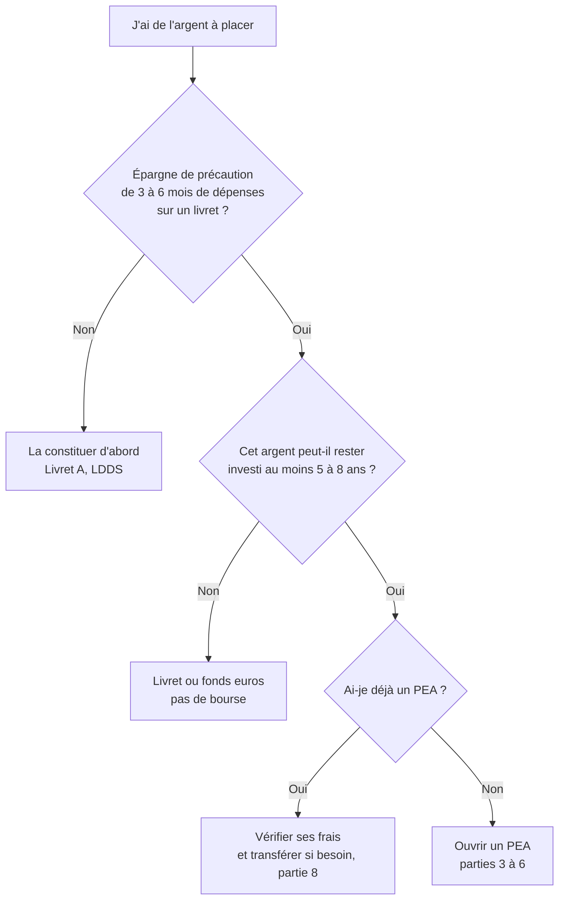
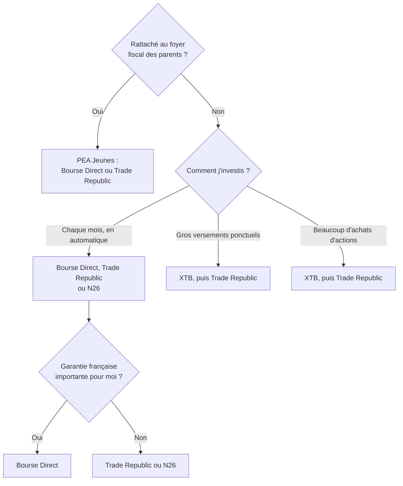

Ce tuto sert à décider **si** ouvrir un PEA, **où** l'ouvrir et **comment** s'en servir jusqu'au jour où l'on retire l'argent. Les offres des courtiers changent souvent : la partie 5 donne une photo des tarifs au **24 octobre 2026**, et la partie 8 explique comment refaire l'analyse soi-même le jour où ces chiffres seront dépassés.

Les recommandations s'appuient sur des études universitaires publiées dans des revues à comité de lecture et sur des organismes publics (Insee, Banque de France, AMF). Les tarifs viennent des grilles officielles publiées par chaque établissement, pas des comparateurs en ligne, souvent rémunérés par affiliation.

 

## 1. Le PEA en bref

Le PEA (Plan d'Épargne en Actions) n'est pas un placement : c'est une **enveloppe fiscale**, un compte qu'on ouvre chez un courtier ou une banque, et dans lequel on achète des actions européennes ou des ETF éligibles.

| **Point** | **Règle** |
|:--|:--|
| Qui | Une personne majeure fiscalement domiciliée en France, un seul PEA par personne |
| Plafond de versements | 150 000 € (PEA classique), 20 000 € pour un jeune majeur rattaché au foyer fiscal de ses parents (PEA Jeunes) |
| Contenu | Actions de l'Union européenne et ETF éligibles, dont des ETF « Monde » à réplication synthétique |
| Fiscalité après 5 ans | Gains exonérés d'impôt sur le revenu, seuls les prélèvements sociaux restent dus (**18,6 %** des gains depuis 2026) |
| Fiscalité avant 5 ans | Un retrait clôture le plan (sauf exceptions) et les gains sont taxés à 31,4 % |
| Transfert | Possible vers un autre établissement **sans perdre l'ancienneté fiscale**, frais plafonnés à 15 €/ligne et 150 € au total |

Le compteur des 5 ans démarre au **premier versement**. Ouvrir un PEA tôt avec une petite somme, même sans investir davantage, fait donc gagner du temps.

 

## 2. Avant d'ouvrir : est-ce le bon moment ?

Pourquoi ces deux conditions :

- **L'épargne de précaution d'abord.** Sans elle, un imprévu oblige à vendre ses placements au pire moment. L'argent disponible est aussi plus lié à la satisfaction de vie que le revenu ou les placements (Ruberton, Gladstone et Lyubomirsky, *Emotion*, 2016).
- **Un horizon long.** Les actions ne sont pas sûres à court terme. Sur 39 pays développés de 1841 à 2019, un investisseur diversifié avait environ **30 % de risque de perdre de l'argent sur 5 ans**, 20 % sur 10 ans et encore 12 % de perdre face à l'inflation sur 30 ans (Anarkulova, Cederburg et O'Doherty, *Journal of Financial Economics*, 2022). L'argent nécessaire avant 5 ans n'a rien à faire en bourse.

 

## 3. Analyser sa situation

Répondre à ces questions avant de comparer les courtiers. Chaque réponse élimine des offres.

| **Question** | **Pourquoi c'est important** |
|:--|:--|
| Suis-je **rattaché au foyer fiscal de mes parents** ? | Si oui, seul un PEA Jeunes est possible (plafond 20 000 €), et plusieurs courtiers n'en proposent pas. Pour le vérifier : son nom figure dans les personnes à charge de l'avis d'impôt des parents (case J de leur déclaration). Le rattachement n'est possible que jusqu'à 21 ans, ou 25 ans pour un étudiant. |
| Comment vais-je **acheter** ? | Un petit montant chaque mois, un gros versement ponctuel, ou beaucoup d'achats d'actions : le classement des courtiers change complètement. |
| Est-ce que je veux un **achat automatique** ? | Les investisseurs qui choisissent eux-mêmes le moment d'acheter gagnent en moyenne 1,3 à 1,5 point de moins par an que les marchés (Dichev, *American Economic Review*, 2007). Un achat programmé supprime cette décision. |
| Comment vais-je **retirer** l'argent ? | Tout d'un coup, par retraits réguliers à la retraite, ou en rente : les frais de vente comptent autant que les frais d'achat sur la durée (partie 7). |
| Est-ce que je tiens à une **garantie française** ? | Les établissements français relèvent du FGDR (titres couverts jusqu'à 70 000 € si le courtier fait faillite et que les titres ont disparu). Les courtiers étrangers relèvent du système de leur pays. |
| Est-ce que je veux **choisir moi-même** ou **déléguer** ? | La gestion pilotée coûte en général 1 à 1,6 % par an, contre 0,2 % pour un ETF Monde acheté soi-même. |

 

## 4. Quoi acheter dans le PEA

Pour la plupart des gens, **un seul ETF Monde** suffit :

- **Diversifier plutôt que choisir.** Aux États-Unis, 4 % des actions ont créé à elles seules toute la richesse nette de la bourse depuis 1926, et plus de la moitié ont fait moins bien qu'un placement sans risque (Bessembinder, *Journal of Financial Economics*, 2018). Un indice mondial évite de devoir deviner lesquelles.
- **Indiciel plutôt qu'actif.** Les fonds gérés activement font en moyenne moins bien que le marché, d'à peu près le montant de leurs frais (Fama et French, *Journal of Finance*, 2010 ; les auteurs sont liés à la société de gestion Dimensional). En France, les ETF actions coûtent 0,33 %/an en moyenne, contre 1,37 % pour les fonds actifs (AMF, 2026).
- **Éligibles au PEA, au 24/10/2026 :** Amundi PEA Monde (DCAM, FR001400U5Q4) et iShares MSCI World Swap PEA (WPEA, IE0002XZSHO1), tous deux à **0,20 %/an**. L'Amundi MSCI World Swap (CW8), plus ancien, coûte 0,38 %.

### ETF Monde ou S&P 500 ?

C'est la question qui revient le plus souvent. Le S&P 500 n'est pas moins bon sur le passé, mais il est plus risqué pour l'avenir : c'est un pari sur un seul pays, que l'ETF Monde contient déjà.

**Le passé donne raison au S&P 500.** Sur 10, 20 et 30 ans, il a battu l'indice Monde d'environ 2 à 3 points par an (par exemple ~12,8 % contre ~10,5 % par an sur 10 ans, selon des comparatifs grand public ; les chiffres varient selon la devise et la période). L'écart n'est pas permanent : en 2025, l'indice Monde a fait mieux.

**Pourquoi ce n'est pas une raison suffisante :**

1. **L'ETF Monde, c'est déjà ~72 % d'actions américaines** (fiche MSCI World de juin 2026). Choisir le S&P 500 revient seulement à retirer les 28 % restants : Europe, Japon, Royaume-Uni, Canada…
2. **Un seul pays, c'est un risque documenté.** Sur 39 pays développés et 180 ans, les études limitées aux États-Unis sous-estiment le risque des actions (Anarkulova, Cederburg et O'Doherty, 2022). Le Japon était la bourse dominante en 1989 : son indice a mis environ 34 ans à retrouver son sommet.
3. **La bourse américaine est chère.** Son ratio CAPE (prix rapporté aux bénéfices moyens sur 10 ans) est d'environ 41 en 2026, contre une moyenne historique d'environ 17. Les travaux de Campbell et Shiller montrent qu'une valorisation élevée annonce en moyenne des rendements plus faibles sur les 10 années suivantes. C'est une tendance statistique débattue, pas un outil pour choisir le moment d'acheter.
4. **Une partie de l'avance passée vient de cette hausse des valorisations** et du dollar. Elle ne peut pas se répéter indéfiniment.

**Les frais avantagent un peu le S&P 500 :**

| **ETF éligible au PEA** | **Frais/an** |
|:--|:--:|
| iShares S&P 500 Swap PEA (SPEA) | 0,10 % |
| Amundi PEA S&P 500 (PSP5) | 0,12 % |
| BNP Paribas Easy S&P 500 (ESE) | 0,14 % |
| Amundi PEA Monde (DCAM) / iShares MSCI World Swap PEA (WPEA) | 0,20 % |

Soit 0,06 à 0,10 point de moins par an, environ 60 à 100 € sur 100 000 €.

**Conclusion :** l'ETF Monde coûte environ 0,1 % de plus par an pour ne pas parier toute son épargne sur un seul pays, déjà très valorisé. Le S&P 500 reste un choix possible, mais concentré. Éviter de cumuler les deux : un S&P 500 ajouté à un ETF Monde porte la part américaine à 80 ou 90 % sans qu'on s'en rende compte.

 

## 5. Les offres au 24 octobre 2026

### Gestion libre

| **Établissement** | **Achat de 1 300 €** | **Achat automatique** | **Droits de garde** | **PEA Jeunes** | **Clôture** | **Garantie** |
|:--|:--:|:--:|:--:|:--:|:--:|:--:|
| Bourse Direct | 0 € (programmé), sinon 2,90 € | Oui, gratuit sur 27 ETF dont DCAM et WPEA | 0 € | Oui | Gratuite | FGDR |
| Trade Republic | 0 € (plan), sinon 1 € | Oui, gratuit | 0 € | Oui | Non trouvé | Allemande |
| XTB | 0 € jusqu'à 100 000 €/mois | Non trouvé | 0 € | Non | Gratuite | Polonaise |
| N26 | 0 € | Plans gratuits | 0 € | Non | Non trouvé | Allemande (compte à déclarer, formulaire 3916) |
| Shares | 2,60 € | Plans programmés gratuits, application au PEA non précisée | 0 € | Non trouvé | Non trouvé | FGDR |
| Interactive Brokers | ~3,75 € | Non trouvé | 0 € | Non | Non trouvé | Irlandaise |
| Fortuneo | 4,55 € | Non | 0 € | Non trouvé | **85 €** | FGDR |
| BforBank | 5 € | Non trouvé | 0 € | Non | **100 €** (grille 2023) | FGDR |
| EasyBourse | 5,85 € | Mise en place gratuite | 0 € | Non trouvé | Non trouvé | FGDR |
| BoursoBank | 6,50 € | Non pour les ETF | 0 € | Oui | Non trouvé | FGDR |
| Monabanq | 6,50 € | Non trouvé | 0 € (6 €/mois sans ordre) | Non trouvé | Non trouvé | FGDR |
| Hello bank! | 6,50 € | Non | **0,40 %/an** (Start) ou 0 € (Active) | Non trouvé | Non trouvé | FGDR |
| Banques de réseau | jusqu'à 6,50 € (plafond légal 0,5 %) | Variable | jusqu'à **0,40 %/an + 5 €/ligne** | En général | jusqu'à 150 € | FGDR |

Sans PEA, vérifié sur leurs sites : DEGIRO, eToro, Revolut, Scalable Capital, Nalo.

### Gestion pilotée

| **Offre** | **Frais annuels tout compris** |
|:--|:--:|
| Yomoni | 1,6 % |
| Ramify | 1,0 à 1,4 % + ~0,2 % de frais d'ETF |

 

## 6. Que choisir aujourd'hui

Coût annuel de courtage selon quatre profils, avec les grilles ci-dessus (droits de garde à 0 € chez tous) :

| **Profil** | **Bourse Direct** | **Trade Republic** | **XTB** | **Interactive Brokers** | **Fortuneo** | **BoursoBank** |
|:--|:--:|:--:|:--:|:--:|:--:|:--:|
| ETF, 300 €/mois | 0 € | 0 € | 0 € | ~45 € | 0 € | ~24 € |
| ETF, 1 300 €/mois | 0 € | 0 € | 0 € | ~45 € | ~55 € | ~78 € |
| Un versement de 20 000 €/an | 18 € | 1 € | 0 € | ~11 € | 30 € | 100 € |
| 5 achats d'actions de 2 000 €/mois | ~174 € | 60 € | 0 € | ~180 € | ~294 € | ~600 € |

**À retenir :**

- Pour un **investissement passif mensuel**, Bourse Direct et Trade Republic sont à 0 € et automatisent l'achat. Bourse Direct est français (FGDR), Trade Republic est moins cher à la revente (partie 7).
- Les **offres avec droits de garde en pourcentage** sont à éviter pour un placement de long terme : sur 100 000 €, 0,40 %/an représente 300 à 400 € chaque année.
- La **gratuité a une contrepartie**. Bourse Direct indique recevoir des émetteurs d'ETF entre 0 % et 0,23 % des encours placés via l'investissement programmé. XTB et Trade Republic se rémunèrent ailleurs (change de devises, autres produits, intérêts sur les liquidités). Une grille gratuite aujourd'hui peut devenir payante demain : c'est une raison de plus de savoir refaire l'analyse (partie 8).

 

## 7. Le jour du retrait

C'est la partie la plus souvent oubliée dans les comparatifs, qui ne regardent que le prix d'achat.

### La fiscalité

| **Quand** | **Ce qui se passe** |
|:--|:--|
| Avant 5 ans | Un retrait **clôture le plan** (sauf exceptions prévues par la loi) et les gains sont taxés à 31,4 % |
| Après 5 ans | Retraits **partiels possibles sans clôturer**, et on peut continuer à verser. Les gains retirés ne paient que les prélèvements sociaux (18,6 % en 2026) |
| Sortie en rente viagère (après 5 ans) | La rente est exonérée d'impôt sur le revenu |

Les prélèvements sociaux portent sur la part de gains contenue dans chaque retrait, pas sur le capital versé.

### Les frais de vente et de clôture

Pour retirer, il faut d'abord **vendre** les ETF : l'investissement programmé gratuit ne concerne en général que les achats. Deux façons typiques de sortir :

| **Sortie** | **Bourse Direct** | **Trade Republic** | **XTB** | **Interactive Brokers** | **Fortuneo** | **BoursoBank** |
|:--|:--:|:--:|:--:|:--:|:--:|:--:|
| Retraits de 2 000 €/mois pendant un an | ~35 € | 12 € | 0 € | ~45 € | ~59 € | ~120 € |
| Vente de 300 000 € en une fois | ~270 € | 1 € | ~400 € (0 € si étalée sur 3 mois) | ~150 € | ~450 € | ~1 500 € |
| Clôture du plan | 0 € | non trouvé | 0 € | non trouvé | 85 € | non trouvé |

Ces frais restent faibles devant la fiscalité, mais ils ne sont pas nuls. Pour quelqu'un qui compte vendre de grosses sommes d'un coup, Trade Republic (1 € par ordre) prend l'avantage. Si les frais de vente de son courtier deviennent trop élevés, **on peut transférer le PEA avant de vendre**, sans perdre l'ancienneté fiscale (150 € au maximum).

 

## 8. Refaire l'analyse quand les offres changent

Les tarifs ci-dessus seront dépassés un jour. Méthode pour les mettre à jour soi-même :

1. **Lister les candidats.** Partir du tableau de la partie 5, et chercher les nouveaux venus (« lancement PEA » et l'année en cours).
2. **Télécharger la grille tarifaire officielle** de chaque établissement (souvent un PDF « conditions tarifaires » ou « brochure tarifaire » en bas du site). Noter sa **date d'application**, et écarter toute grille de plus d'un an.
3. **Relever pour le PEA**, pas pour le compte-titres :
   - le prix d'un achat au montant que l'on investit réellement ;
   - l'existence et le prix d'un achat automatique, et la liste des ETF concernés ;
   - les droits de garde et frais de tenue de compte ;
   - le prix d'une vente à la sortie, la clôture et le transfert sortant ;
   - l'acceptation des rattachés (PEA Jeunes) ;
   - le pays de l'établissement et sa garantie.
4. **Calculer son coût annuel :** (frais d'achat × nombre d'achats) + (droits de garde × valeur du portefeuille) + les frais de sortie prévus. Faire le calcul pour la valeur actuelle et pour la valeur visée dans 10 ou 20 ans : les frais en pourcentage pèsent de plus en plus.
5. **Ignorer les promotions temporaires** : elles durent quelques mois, le PEA des décennies.
6. **Se méfier des comparateurs** qui ne citent pas leurs sources : beaucoup sont rémunérés par les courtiers qu'ils classent.
7. **Si un meilleur courtier apparaît**, transférer son PEA plutôt que le clôturer : l'ancienneté fiscale est conservée.

 

## 9. Ouvrir son PEA, étape par étape

1. Vérifier sa situation (partie 3), en particulier le rattachement fiscal.
2. Choisir le courtier (parties 5 et 6) et revérifier sa grille du jour.
3. Ouvrir le PEA en ligne : pièce d'identité, justificatif de domicile, RIB.
4. Faire un **premier versement**, même petit, pour lancer le compteur des 5 ans.
5. Acheter l'ETF Monde choisi, puis programmer l'achat mensuel le lendemain du salaire, avec un virement permanent du compte courant vers le PEA.
6. Ne plus y toucher : ne pas vendre pendant les baisses, ne pas acheter selon l'actualité (Barber et Odean, *Journal of Finance*, 2000 : les particuliers qui échangent le plus gagnent le moins).

 

## Sources

**Études universitaires**
- Anarkulova, Cederburg et O'Doherty (2022), *Stocks for the long run? Evidence from a broad sample of developed markets*, Journal of Financial Economics ([présentation](https://corpgov.law.harvard.edu/2021/12/13/stocks-for-the-long-run-evidence-from-a-broad-sample-of-developed-markets)).
- Bessembinder (2018), *Do stocks outperform Treasury bills?*, Journal of Financial Economics ([PDF](https://wpcarey.asu.edu/sites/default/files/2021-10/do-stocks-outperform-treasury-bills.pdf)).
- Fama et French (2010), *Luck versus Skill in the Cross-Section of Mutual Fund Returns*, Journal of Finance ([PDF](https://mba.tuck.dartmouth.edu/bespeneckbo/default/AFA611-Eckbo%20web%20site/AFA611-S8C-FamaFrench-LuckvSkill-JF10.pdf)).
- Dichev (2007), *What Are Stock Investors' Actual Historical Returns?*, American Economic Review ([PDF](https://www.stern.nyu.edu/sites/default/files/assets/documents/Ilia%20Dichev.pdf)).
- Barber et Odean (2000), *Trading Is Hazardous to Your Wealth*, Journal of Finance ([PDF](https://faculty.haas.berkeley.edu/odean/Papers%20current%20versions/Individual_Investor_Performance_Final.pdf)).
- Ruberton, Gladstone et Lyubomirsky (2016), *How your bank balance buys happiness*, Emotion ([PDF](https://www.repository.cam.ac.uk/bitstream/1810/255023/1/Ruberton_et_al-2016-Emotion-AM.pdf)).

- Travaux de Campbell et Shiller sur le ratio CAPE et les rendements de long terme ([synthèse et comparaison des ratios](https://cxoadvisory.com/fundamental-valuation/comparing-cape-to-other-stock-market-valuation-ratios)).

**ETF Monde ou S&P 500 (données de marché)**
- Poids des États-Unis dans le MSCI World : [Rivaria Capital](https://rivaria-capital.com/articles/msci-world-composition), d'après la fiche MSCI de juin 2026.
- Performances comparées : [Invesse](https://invesse.fr/bourse/etf-sp500-vs-msci-world/), [Financelabs](https://financelabs.fr/article/18-msci-world-ou-sp500), [Investing in the Web](https://investingintheweb.com/education/sp500-vs-msci-world/) (comparatifs grand public, à recouper avec les fiches officielles des indices).
- Niveau du CAPE américain en 2026 : [Gotrade](https://www.heygotrade.com/en/blog/cape-ratio-explained-is-sp-500-expensive-may-2026/).
- Frais des ETF S&P 500 éligibles au PEA : [pea.fr](https://pea.fr/etf/meilleurs-etf-sp-500-pea/), [Finary](https://finary.com/en/blog/bourse/etf/sp500-etf).

**Organismes publics et textes**
- Article L. 221-30 du Code monétaire et financier, via le [BOFiP](https://bofip.impots.gouv.fr/bofip/1415-PGP.html).
- AMF, [Lettre de l'Observatoire de l'épargne n°65](https://www.amf-france.org/sites/institutionnel/files/private/2026-04/loe-65_1.pdf) et [étude sur les frais des fonds](https://www.amf-france.org/sites/institutionnel/files/private/2024-05/etude-analyse-des-frais_fr_0.pdf).
- AMF, [protection des titres en cas de faillite de l'intermédiaire](https://www.amf-france.org/fr/mes-titres-sont-ils-proteges-en-cas-de-faillite-de-mon-intermediaire-financier-0).
- Banque de France, [rapport OPEF 2025](https://www.banque-france.fr/system/files/2025-09/OPEF2025.pdf).

**Grilles tarifaires officielles consultées le 24/10/2026**
- [Bourse Direct](https://www.boursedirect.fr/pdf/tarifs_bd.pdf) (06/01/2026) et [investissement programmé](https://www.boursedirect.fr/fr/investissements-programmes)
- [Fortuneo](https://www.fortuneo.fr/files/tarifs_fortuneo.pdf) (06/08/2026)
- [BoursoBank](https://www.boursobank.com/content/brochure_tarifaire/boursorama_bt-new.pdf) (05/10/2026)
- [Trade Republic](https://assets.traderepublic.com/assets/files/CA_FR-en-fr.pdf) (contrat client, annexe PEA)
- [XTB](https://www.xtb.com/fr/fichiers/table-des-frais-et-commissions_052026.pdf) (30/09/2026)
- [N26](https://n26.com/fr-fr/pea), [Shares](https://www.shares.io/terms/fees), [Interactive Brokers](https://www.interactivebrokers.ie/fr/pricing/commissions-stocks-europe.php)
- [EasyBourse](https://documents.easybourse.com/formulaires_clients/brochure-tarifaire-bourse.pdf) (01/06/2026), [Hello bank!](https://www.hellobank.fr/content/dam/hellobank/rsc/contrib/document/pdf/tarifs-hellobank.pdf) (01/10/2026), [Monabanq](https://www.monabanq.com/fr/pdf/tarifications/monabanq_tarification.pdf) (01/10/2026)
- [BforBank](https://www2.bforbank.com/bourse-pea.html), [Saxo](https://www.home.saxo/fr-fr/accounts/pea), [Yomoni](https://www.yomoni.fr/tarifs), [Ramify](https://www.ramify.fr/produits/pea)
