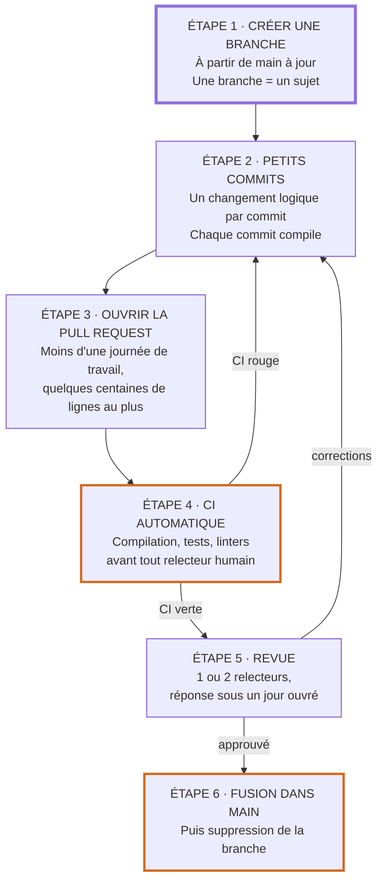
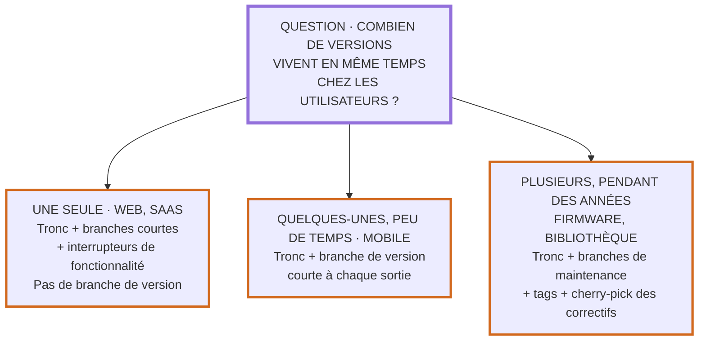

Bienvenue sur cette page où tu vas pouvoir apprendre comment et pourquoi organiser ton travail avec Git, en t'appuyant uniquement sur ce qui a été mesuré par la recherche ou sur ce que personne de sérieux ne conteste.

Beaucoup de « bonnes pratiques » Git circulent sans preuve. Pour s'y retrouver, chaque recommandation de cette page est classée dans une de ces trois catégories :

- **Prouvé** : des études empiriques (articles relus par les pairs, grandes enquêtes) vont dans ce sens.
- **Consensus** : aucune étude dédiée, mais la documentation officielle de Git, du noyau Linux, de Google, etc. le recommande et personne ne le conteste.
- **Goût** : une convention utile mais arbitraire. Choisis-en une et tiens-t'y, mais ne la défends pas comme une vérité.

## La réponse courte à la question « ça dépend du contexte ? »
**Non pour l'essentiel, oui pour un point précis.**

- La **taille de l'équipe** (2 contre 20) ne change pas le modèle de branches. Elle change l'outillage de coordination autour : protection de branche, propriétaires de code, file de fusion. Aucune étude ne compare directement les méthodes Git selon le nombre de développeurs. Les recherches qui existent montrent que c'est le **couplage de l'architecture** qui compte, plus que l'effectif (Conway 1968, MacCormack et al. 2012, Nagappan et al. 2008, DORA).
- Le **type de programmation** (embarqué contre web) change une seule chose importante : **le nombre de versions qui vivent en même temps chez les utilisateurs**. Un site web n'a qu'une version en production, qu'on remplace quand on veut. Un firmware est livré en versions numérotées qu'il faut maintenir parfois pendant des années. C'est ce critère, et lui seul, qui décide s'il faut des branches de maintenance.

Le reste de la page détaille ces deux réponses. Pour une équipe qui fait uniquement de l'embarqué avec un simple serveur Git, une version réduite à l'essentiel existe : [Git pour une équipe embarquée](../git_embarque/).

## Le principe central : petits lots, intégration fréquente
C'est le résultat le plus solide de toute la littérature. Plus une modification reste longtemps isolée du tronc commun (la branche `main`), plus elle coûte cher à intégrer.

Les chiffres :

- Sur 9 projets open source et 550 000 versions, **16 % des fusions** ont demandé une résolution manuelle de conflit, et **33 % des fusions que Git jugeait propres** cassaient en réalité la compilation ou les tests. Un conflit reste en moyenne **10 jours** dans le code avant d'être découvert (Brun et al. 2011).
- Chez Microsoft, sur Windows Vista et Windows 7, l'activité sur les branches est associée à **jusqu'à 59 % de défaillances en plus** après livraison (Shihab et al. 2012).
- Toujours chez Microsoft, supprimer les branches coûteuses et peu utiles aurait fait gagner **8,9 jours** de délai chacune, pour seulement **0,04 conflit** supplémentaire en moyenne (Bird et Zimmermann 2012).
- Le programme de recherche DORA (Google) relie depuis 2014 les petits lots et l'intégration fréquente à de meilleures performances de livraison. Ses recommandations : **trois branches actives au plus**, fusion dans le tronc **au moins une fois par jour**, **pas de gel du code**.

Martin Fowler résume le mécanisme : « Le problème des grosses fusions n'est pas tant le travail qu'elles demandent que l'incertitude de ce travail ». Les branches divergent d'autant plus vite qu'on attend pour les réunir, et la peur des fusions pénibles pousse à fusionner encore moins souvent. Son conseil : **chercher à doubler sa fréquence d'intégration**.

Une nuance honnête : en 2022 et 2023, DORA a observé que le développement sur tronc (« trunk-based development ») pris isolément aidait surtout les équipes **expérimentées**, et pouvait augmenter l'épuisement chez les autres. L'explication avancée : cette méthode exige une discipline stricte, notamment **ne jamais laisser le tronc cassé**. Le principe des petits lots, lui, n'a jamais été remis en cause.

Statut : **prouvé** pour le principe, **goût** pour les seuils exacts (« 3 branches », « 1 jour »), qui viennent d'enquêtes corrélationnelles.

## Le modèle de branches
### Le modèle par défaut : un tronc et des branches courtes
Voici le chemin d'une modification, de l'idée jusqu'au tronc :



Les règles qui l'accompagnent :

- **Une branche ne dure que quelques jours au plus**, le temps d'attente de la revue compris, et n'a qu'un seul développeur (deux en binôme). Elle est supprimée après la fusion (trunkbaseddevelopment.com).
- **`main` est toujours livrable.** Si un commit casse la CI sur `main`, le réparer passe avant tout le reste.
- **Une fonctionnalité trop longue pour une seule branche** ne justifie pas une branche longue. On la fusionne par morceaux, cachée derrière un interrupteur (« feature flag »), ou on utilise la technique de la « branche par abstraction » : on crée une interface, on écrit la nouvelle implémentation derrière, on bascule, puis on supprime l'ancienne.

Statut : **consensus** (DORA, Fowler, Google, GitHub Flow, documentation GitLab).

### Attention aux interrupteurs de fonctionnalité
Les interrupteurs sont utiles, mais ils s'accumulent. Dans Chrome, ils sont souvent restés en place longtemps et sont devenus de la dette technique (Rahman et al. 2016). Dans une étude par entretiens, **retirer les interrupteurs obsolètes** est cité par tous comme la principale difficulté, et moins le processus de retrait est strict, plus les problèmes sont nombreux (Meinicke et al. 2020).

Le cas d'école est Knight Capital en 2012 : un ancien interrupteur a été réutilisé pour une nouvelle fonction, alors que du vieux code mort qui en dépendait était resté sur un des huit serveurs. Résultat : **460 millions de dollars perdus en 45 minutes** (rapport de la SEC, 2013).

Règle : **donner une date de retrait à chaque interrupteur dès sa création, et ne jamais en réutiliser un.**

### Quand ajouter des branches de version
Si ton logiciel existe en plusieurs versions chez les utilisateurs et qu'il faut corriger les anciennes, il faut des branches de version (`release/v1.2`). La règle est la même partout, du noyau Linux à Zephyr, ESP-IDF, Google et Facebook :

1. On crée la branche de version **à partir du tronc**, le plus tard possible.
2. Une correction se fait **d'abord sur `main`**, puis on la recopie (`git cherry-pick`) sur la branche de version. Jamais l'inverse.
3. On ne développe pas de nouvelle fonctionnalité sur une branche de version.

C'est ce qu'on appelle « upstream first ». Statut : **consensus**.

### Et GitFlow ?
GitFlow (branches `develop`, `feature`, `release`, `hotfix`) a été très populaire. Son propre auteur, Vincent Driessen, a ajouté en 2020 une note à son article d'origine : pour une équipe qui livre en continu, comme une application web, il conseille « un flux beaucoup plus simple (comme GitHub flow) ». Il précise que GitFlow reste adapté aux logiciels **explicitement versionnés** ou dont **plusieurs versions vivent en même temps**, et rappelle que « les panacées n'existent pas ».

Même dans ce cas, le modèle « tronc + branches de version » ci-dessus couvre le besoin sans la branche `develop`. Statut : **consensus** sur le fait que GitFlow est inadapté au web, **goût** pour le choix entre GitFlow et tronc + versions sur un produit versionné.

## Les commits
### Un changement logique par commit, et chaque commit compile
La documentation officielle de Git le dit ainsi : « découpe tes modifications en petites étapes logiques, et commite chacune d'elles. Elles doivent être cohérentes, fonctionner indépendamment des commits suivants, passer les tests » (gitworkflows). Le noyau Linux impose la même chose : « sépare chaque changement logique dans un patch séparé ».

Pourquoi c'est important :

- **Pour retrouver un bug.** `git bisect` cherche par dichotomie le commit qui a introduit un bug : sur 1 000 commits, une dizaine d'essais suffisent. Mais un commit qui ne compile pas ne peut pas être testé, et s'il est voisin du coupable, Git ne peut plus dire lequel des deux est fautif.
- **Pour annuler proprement.** Un commit qui ne fait qu'une chose s'annule (`git revert`) sans emporter le reste.
- **Parce que les commits emmêlés sont fréquents et faussent l'historique.** Jusqu'à 15 % des corrections de bugs mélangent plusieurs changements (Herzig et Zeller 2013), et dans les commits de correction, seules 17 à 32 % des lignes modifiées corrigent réellement le bug (Herbold et al. 2022).

Statut : **consensus** pour la règle, **prouvé** pour la fréquence et le coût des commits emmêlés.

L'outil pour y arriver quand on a tout modifié d'un coup : `git add -p`, qui permet de choisir morceau par morceau ce qui entre dans le commit. Et en cas de doute, mieux vaut des commits trop petits : il est toujours plus facile d'en fusionner plusieurs que d'en découper un gros (gitworkflows).

### Le message explique le pourquoi
Le code montre **ce qui** a changé. Le message doit surtout dire **pourquoi**. Sur 1 597 commits de 5 projets Java, environ **44 % des messages** étaient de mauvaise qualité, et l'absence de « pourquoi » était deux fois plus fréquente que l'absence de « quoi » (Tian et al. 2022).

La forme recommandée par Git lui-même : une première ligne courte qui résume, une ligne vide, puis un corps qui explique le problème et la solution retenue.

```text
fix(uart): vider le tampon de réception avant le passage en veille

Le microcontrôleur se réveillait en boucle quand un octet arrivait
pendant l'entrée en veille : l'interruption restait en attente.
On vide le tampon et on acquitte l'interruption avant d'appeler
HAL_PWR_EnterSTOPMode().
```

Ce qui relève du **consensus** : la structure titre / ligne vide / corps, le titre à l'impératif (« Corrige », pas « Corrigé »), l'explication du pourquoi.

Ce qui relève du **goût** :

- La limite de 50 caractères pour le titre et 72 pour le corps vient des terminaux de 80 colonnes (Tim Pope 2008). Son auteur lui-même dit que ce n'est pas un maximum strict.
- Conventional Commits (`feat:`, `fix:`, `docs:`...) est une convention communautaire. Son vrai intérêt est l'outillage : elle se branche directement sur le versionnage sémantique (SemVer), où `fix` donne une version corrective, `feat` une version mineure, et `!` ou `BREAKING CHANGE:` une version majeure. Cela permet de générer automatiquement le numéro de version et le journal des modifications.

## La revue de code
### Ce qu'une revue apporte vraiment
Contrairement à l'intuition, la revue moderne trouve **peu de bugs**. Chez Microsoft, les défauts ne représentaient que **14 % des commentaires** de revue, quatrième catégorie seulement (Bacchelli et Bird 2013). Chez Google, sur 9 millions de modifications relues, la motivation principale est la **transmission de connaissance** (Sadowski et al. 2018).

La revue sert donc d'abord à ce que **plus d'une personne connaisse chaque partie du code**, et à améliorer sa lisibilité. Les auteurs de l'étude Microsoft préviennent : compter sur la revue comme principal filet de sécurité qualité « peut être hasardeux ». Ce sont les tests qui jouent ce rôle.

Cela dit, une revue bâclée coûte cher : sur Qt, VTK et ITK, les composants avec une faible participation aux revues ont **jusqu'à cinq défauts de plus après livraison**, et les modifications approuvées sans aucune discussion sont parmi les plus risquées (McIntosh et al. 2014). Une approbation de façade ne sert à rien.

Statut : **prouvé**.

### Les règles pratiques
- **Petites modifications.** Chez Google, la médiane est de **24 lignes modifiées** et 90 % des modifications touchent moins de 10 fichiers. Plus une modification est grosse, moins les commentaires sont utiles et plus la revue est lente (Sadowski et al. 2018). Le guide de Google donne un ordre de grandeur : **100 lignes est généralement raisonnable, 1 000 lignes généralement trop**. **Prouvé** pour la tendance, **goût** pour les seuils.
- **1 ou 2 relecteurs.** Chrome, Android et les grands projets open source convergent vers une médiane de 2 (Rigby et Bird 2013). Google fonctionne avec une médiane de 1. Au-delà de 2, rien ne montre un bénéfice. **Consensus** sur « 1 ou 2 », **contesté** sur « 2 est optimal ».
- **Répondre vite.** Un jour ouvré au maximum pour une première réponse (guide de Google). Chez Google, la revue complète prend moins de 4 heures en médiane. **Consensus**.
- **Approuver quand ça améliore le code, pas quand c'est parfait.** « Le code parfait n'existe pas, il n'existe que du code meilleur » (guide de Google). Les remarques facultatives sont préfixées par « Nit: ». **Consensus**.
- **Automatiser avant de relire.** Le formatage, le style et les erreurs simples sont vérifiés par la CI et les linters, pas par un humain. Sur 246 projets GitHub, l'adoption de l'intégration continue a augmenté le nombre de contributions intégrées **sans baisse visible de la qualité** (Vasilescu et al. 2015). **Prouvé**.
- **Des sessions de relecture courtes.** Fagan (IBM, 1976) constatait que l'efficacité chute après 2 heures. L'étude SmartBear chez Cisco (2006) propose moins de 400 lignes par revue, moins de 500 lignes par heure, moins de 60 à 90 minutes par session. Ces chiffres viennent d'une étude d'éditeur, non relue par les pairs, sur une seule entreprise : **à prendre comme ordres de grandeur, pas comme des lois**.

### Et le travail en binôme ?
La méta-analyse de Hannay et al. (2009) trouve un **petit effet positif sur la qualité** et une **réduction du temps total**, mais au prix d'un **effort nettement plus élevé** (deux personnes sur la même tâche). L'effet varie beaucoup d'une étude à l'autre. C'est un complément à la revue, pas un remplacement prouvé.

## L'hygiène du dépôt
### Ne jamais commiter de secret
C'est le seul point de cette page où une erreur se paie immédiatement. Sur GitHub, une étude a trouvé plus de 100 000 dépôts exposant des clés d'API ou des clés privées, et des milliers de nouvelles fuites chaque jour. Leur scanner découvrait un secret en **20 secondes** en médiane après sa publication, et **81 % des secrets** trouvés n'étaient jamais retirés (Meli et al. 2019). Le rapport GitGuardian 2026 compte 28,65 millions de nouveaux secrets publiés sur GitHub en 2025.

Ce qu'il faut savoir :

- **Supprimer le fichier ou réécrire l'historique ne suffit pas.** Le commit reste accessible par les clones, les forks et les caches. La première action est de **révoquer le secret et d'en créer un nouveau** (documentation GitHub).
- La prévention : mettre les secrets dans des variables d'environnement ou un fichier ignoré, et activer un scanner de secrets (par exemple la protection « push protection » de GitHub).

Statut : **prouvé**.

### Le reste de l'hygiène
- **Créer le `.gitignore` avant le premier commit**, avec les fichiers générés (dossiers `build/`, binaires compilés, journaux, fichiers de l'IDE). Des modèles existent pour chaque langage sur [github/gitignore](https://github.com/github/gitignore). Attention, un fichier déjà suivi n'est pas affecté par le `.gitignore` : il faut d'abord le retirer avec `git rm --cached`. **Consensus**.
- **Les gros fichiers binaires vont dans Git LFS.** GitHub avertit au-delà de 50 Mo et bloque au-delà de 100 Mo par fichier. **Consensus**.
- **Les hooks locaux ne garantissent rien.** Un hook `pre-commit` se contourne avec `--no-verify` et n'est pas copié lors d'un clone. Ils sont utiles pour le confort, mais ce qui doit être garanti se vérifie **côté serveur**, dans la CI rendue obligatoire. **Consensus**.
- **Ne jamais réécrire un historique partagé.** « Ne rebase pas des commits qui existent en dehors de ton dépôt et sur lesquels d'autres ont pu baser leur travail » (Pro Git). Sur ta propre branche, avant que quelqu'un ne s'en serve, réorganiser ses commits est au contraire une bonne pratique. **Consensus**.
- **Protéger `main`** : pas de `push --force`, pas de suppression, CI verte obligatoire avant fusion. **Consensus**.

## Ce qui change selon le contexte
### Équipe de 2 contre équipe de 20
Le nombre de canaux de communication entre n personnes vaut n(n-1)/2 (Brooks 1975) : **1 canal à 2, 190 canaux à 20**. Ce n'est pas le modèle de branches qui doit absorber cette différence, c'est l'outillage de coordination.

| **Pratique**                                        | **Équipe de 2**                                    | **Équipe de 20**                                       |
|---------------------------------------------------- |--------------------------------------------------- |------------------------------------------------------- |
| Tronc + branches courtes                             | Oui                                                | Oui                                                    |
| Commits atomiques, CI verte, pas de secret           | Oui                                                | Oui                                                    |
| Protection de `main` (pas de force push, CI exigée)  | Oui, ça ne coûte rien                              | Oui                                                    |
| Revue obligatoire avant fusion                       | Oui, l'autre relit tout                            | Oui, 1 ou 2 relecteurs                                 |
| Fichier `CODEOWNERS`                                 | Inutile                                            | Utile pour router la revue vers ceux qui connaissent le code |
| File de fusion (« merge queue »)                     | Inutile                                            | Utile dès que plusieurs fusions par jour se croisent   |
| Découper le code en modules découplés                | Peu critique                                       | Essentiel                                              |

<br>

Deux points méritent une explication :

- **La file de fusion** répond à un vrai problème d'échelle : deux pull requests peuvent avoir chacune une CI verte et casser `main` une fois fusionnées ensemble. Chez Uber, avant la mise en place d'une file de fusion, la branche principale de l'application iOS n'était verte que **52 % du temps** sur la semaine étudiée (Ananthanarayanan et al. 2019). **Prouvé**, mais le seuil à partir duquel elle devient nécessaire relève du jugement.
- **Le découpage du code** compte plus que l'effectif. La loi de Conway (1968) dit qu'un système reproduit la structure de communication de l'organisation qui le conçoit. Les études le confirment : les organisations faiblement couplées produisent des logiciels nettement plus modulaires (MacCormack et al. 2012), et chez Microsoft la structure de l'organisation prédit mieux les défaillances de Windows Vista que la complexité du code (Nagappan et al. 2008). **Prouvé**.

### Embarqué contre web
Voici l'arbre de décision, qui ne dépend que de la façon dont le logiciel est livré :



**En web**, on remplace la version en production quand on veut, donc il n'y a rien à maintenir en parallèle. Quand on livre plusieurs fois par jour, DORA note que les branches de version ne sont même plus nécessaires.

**En mobile**, chez Facebook, une branche de version est créée toutes les deux semaines à partir du tronc, stabilisée pendant cinq jours, puis abandonnée (Rossi et al. 2016).

**En embarqué**, un firmware déjà flashé dans un produit ne se met pas à jour facilement, et plusieurs versions coexistent sur le terrain. Les projets de référence le montrent :

- **ESP-IDF** crée une branche `release/v5.x` par version, maintenue **30 mois** (12 mois de service complet, puis 18 mois de correctifs de sécurité et de bugs graves uniquement), et suit le versionnage sémantique.
- **Zephyr** crée une branche `v4.4-branch` à chaque version, et ses versions LTS sont maintenues **au moins 5 ans**. Un correctif fait sur une LTS doit aussi être proposé sur le tronc.
- **Le noyau Linux** n'accepte un correctif sur une branche stable que s'il existe déjà dans le tronc principal, avec la référence du commit d'origine.

Ce qui s'ajoute en embarqué :

- **Tracer chaque binaire jusqu'à son commit.** `git describe --tags --dirty` produit une chaîne comme `v1.2.0-14-g2414721-dirty` : dernier tag, nombre de commits depuis, identifiant du commit, et `-dirty` si des modifications n'étaient pas commitées. ESP-IDF l'intègre automatiquement dans le firmware quand aucune version n'est définie. Un firmware compilé avec `-dirty` ne devrait jamais être livré.
- **Viser des compilations reproductibles** : avec le même code source, le même environnement et les mêmes instructions, n'importe qui doit pouvoir recréer un binaire identique bit à bit (reproducible-builds.org).
- **Figer les dépendances.** Les SDK constructeurs se gèrent par sous-modules Git, par manifeste (`west` chez Zephyr) ou en copiant le code dans le dépôt. Aucune étude ne départage ces solutions, mais toutes doivent pointer vers une version exacte (un identifiant de commit, pas une branche qui bouge).
- **Les fichiers binaires de CAO** (Altium, la plupart des formats mécaniques) ne se fusionnent pas : Git LFS avec verrouillage de fichier évite que deux personnes les modifient en même temps. Les fichiers KiCad, eux, sont du texte et se comparent normalement.
- **Une CI plus lente.** Les tests sur matériel réel (« hardware in the loop ») sont rares et lents, ce qui est un frein connu à l'intégration continue en embarqué (Mårtensson et al. 2016, chez Saab et Ericsson). Ça ne justifie pas des branches longues : on garde une CI rapide (compilation, tests unitaires sur PC, analyse statique) à chaque pull request, et les tests matériels tournent sur `main` à intervalle régulier.
- **Les normes de sûreté** (IEC 61508, ISO 26262, IEC 62304 pour le médical, DO-178C pour l'aéronautique) exigent une gestion de configuration : identifier chaque élément, figer des versions de référence, contrôler et tracer les modifications, pouvoir tout reconstruire. Aucune n'impose Git ni un modèle de branches. Les tags, les pull requests relues et `git describe` y répondent. DORA n'a d'ailleurs trouvé aucune preuve qu'un processus d'approbation externe plus lourd réduise les échecs de mise en production, et recommande la revue par les pairs pour assurer la séparation des responsabilités.

## Exemple de journée de travail
Voici l'ensemble des recommandations appliquées à un projet firmware, du début d'une tâche jusqu'à la livraison d'un correctif sur une ancienne version.

1 - On part d'un tronc à jour et on crée une branche pour un seul sujet.

```bash
git switch main
git pull
git switch -c fix/uart-veille
```

2 - On travaille, puis on commite par petits changements logiques, en choisissant les morceaux un par un.

```bash
git add -p
git commit
```

3 - Avant de pousser, on se remet à jour sur `main`. Cette branche n'a encore été vue par personne, donc on peut rebaser sans risque.

```bash
git fetch
git rebase origin/main
git push -u origin fix/uart-veille
```

On ouvre ensuite la pull request. Si on doit corriger après une remarque de revue et réécrire la branche, on pousse avec `git push --force-with-lease`, qui refuse d'écraser un travail que quelqu'un d'autre aurait ajouté entre-temps.

4 - Après approbation et CI verte, on fusionne et on supprime la branche.

```bash
git switch main
git pull
git branch -d fix/uart-veille
```

5 - On livre une version : on crée un tag annoté sur `main`, puis la branche de maintenance.

```bash
git tag -a v1.3.0 -m "Version 1.3.0"
git push origin v1.3.0
git branch release/v1.3 v1.3.0
git push origin release/v1.3
```

6 - Un bug est trouvé sur le terrain en v1.3.0. Le correctif est d'abord fusionné dans `main` par une pull request normale, puis recopié sur la branche de maintenance. L'option `-x` ajoute au message la référence du commit d'origine, pour la traçabilité.

```bash
git switch release/v1.3
git cherry-pick -x <identifiant_du_commit_sur_main>
git tag -a v1.3.1 -m "Version 1.3.1"
git push origin release/v1.3 v1.3.1
```

Conclusion : un seul tronc, des branches de quelques jours, des commits qui compilent, une revue rapide, et des branches de version uniquement parce que des firmwares v1.3 tournent encore chez des clients. Pour un site web, on s'arrêterait à l'étape 4.

## Ce qui reste une affaire de goût
Ces débats reviennent souvent, mais **aucune étude ne départage les camps**. Choisis une règle par projet, écris-la dans le README, et applique-la.

- **Merge, rebase ou squash** pour fusionner une pull request. Le squash donne un historique linéaire avec une seule unité à annuler par fonctionnalité, mais perd le détail des commits pour `git bisect` et `git blame`. Pro Git lui-même conclut : « c'est à toi de décider ce qui convient le mieux à ta situation ». La seule règle non négociable reste de ne pas réécrire un historique partagé.
- **50/72 caractères**, majuscule ou non au début du titre (le projet Git lui-même écrit `doc: clarify...` sans majuscule).
- **Conventional Commits** ou un autre format.
- **Monodépôt ou plusieurs dépôts.** L'étude de Google (Jaspan et al. 2018) montre un vrai compromis : visibilité et gestion centralisée des dépendances d'un côté, souplesse et contrôle d'accès de l'autre. L'outillage pèse autant que le choix lui-même.
- **Commit direct sur `main` ou pull request obligatoire** dans une très petite équipe expérimentée. trunkbaseddevelopment.com accepte le commit direct pour les très petites équipes. La pull request reste le choix par défaut dès qu'on veut une revue tracée.

## Source
- Forsgren N., Humble J., Kim G., *Accelerate: The Science of Lean Software and DevOps*, IT Revolution, 2018.

- DORA, *Capabilities: Trunk-based development*, *Loosely coupled teams*, *Streamlining change approval* ([lire en ligne](https://dora.dev/capabilities/trunk-based-development/)). C'est de là que viennent les recommandations « trois branches actives au plus », « fusion au moins une fois par jour » et « pas de gel du code ».

- DORA, *Accelerate State of DevOps Report*, 2022 (p. 30-31 et 55-56) et 2023 (p. 21-24) ([2022](https://services.google.com/fh/files/misc/2022_state_of_devops_report.pdf), [2023](https://services.google.com/fh/files/misc/2023_final_report_sodr.pdf)). Ce sont ces rapports qui nuancent l'effet du développement sur tronc selon l'expérience des équipes.

- Fowler M., *Patterns for Managing Source Code Branches*, 2020 ([lire en ligne](https://martinfowler.com/articles/branching-patterns.html)).

- Hammant P., *Trunk Based Development* ([lire en ligne](https://trunkbaseddevelopment.com/)).

- Driessen V., *A successful Git branching model*, 2010, note de réflexion du 5 mars 2020 ([lire en ligne](https://nvie.com/posts/a-successful-git-branching-model/)).

- Brun Y., Holmes R., Ernst M., Notkin D., *Proactive detection of collaboration conflicts*, ESEC/FSE 2011 ([lire en ligne](https://homes.cs.washington.edu/~mernst/pubs/vc-conflicts-fse2011.pdf)).

- Shihab E., Bird C., Zimmermann T., *The effect of branching strategies on software quality*, ESEM 2012, p. 301-310 ([lire en ligne](https://thomas-zimmermann.com/publications/files/shihab-esem-2012.pdf)).

- Bird C., Zimmermann T., *Assessing the value of branches with what-if analysis*, FSE 2012 ([lire en ligne](https://www.microsoft.com/en-us/research/publication/assessing-the-value-of-branches-with-what-if-analysis/)).

- Rahman M. T., Querel L.-P., Rigby P., Adams B., *Feature toggles: practitioner practices and a case study*, MSR 2016, p. 201-211.

- Meinicke J., Wong C.-P., Vasilescu B., Kästner C., *Exploring Differences and Commonalities between Feature Flags and Configuration Options*, ICSE-SEIP 2020 ([lire en ligne](https://www.cs.cmu.edu/~ckaestne/pdf/icseseip20.pdf)).

- U.S. Securities and Exchange Commission, *In the Matter of Knight Capital Americas LLC*, Release No. 34-70694, 16 octobre 2013 ([lire en ligne](https://www.sec.gov/files/litigation/admin/2013/34-70694.pdf)).

- Chacon S., Straub B., *Pro Git*, 2e édition, sections 3.6 « Rebasing », 5.2 « Contributing to a Project », 7.10 « Debugging with Git », 8.3 « Git Hooks » ([lire en ligne](https://git-scm.com/book/fr/v2)).

- Documentation officielle de Git : *gitworkflows*, *git-commit*, *git-bisect*, *git-describe*, *gitignore*, *githooks* ([lire en ligne](https://git-scm.com/docs/gitworkflows)).

- The Linux kernel documentation, *Submitting patches* et *Everything you ever wanted to know about Linux -stable releases* ([lire en ligne](https://docs.kernel.org/process/submitting-patches.html)).

- Tian Y., Zhang Y., Stol K.-J., Jiang L., Liu H., *What Makes a Good Commit Message?*, ICSE 2022 ([lire en ligne](https://arxiv.org/abs/2202.02974)).

- Herzig K., Zeller A., *The Impact of Tangled Code Changes*, MSR 2013, p. 121-130 ([lire en ligne](https://www.st.cs.uni-saarland.de/publications/files/herzig-msr-2013.pdf)).

- Herbold S. et al., *A fine-grained data set and analysis of tangling in bug fixing commits*, Empirical Software Engineering 27(6), 2022 ([lire en ligne](https://arxiv.org/abs/2011.06244)).

- Pope T., *A Note About Git Commit Messages*, 2008 ([lire en ligne](https://tbaggery.com/2008/04/19/a-note-about-git-commit-messages.html)).

- *Conventional Commits 1.0.0* ([lire en ligne](https://www.conventionalcommits.org/fr/v1.0.0/)) et *Semantic Versioning 2.0.0* ([lire en ligne](https://semver.org/lang/fr/)).

- Bacchelli A., Bird C., *Expectations, Outcomes, and Challenges of Modern Code Review*, ICSE 2013 ([lire en ligne](https://www.microsoft.com/en-us/research/wp-content/uploads/2016/02/ICSE202013-codereview.pdf)).

- Sadowski C. et al., *Modern Code Review: A Case Study at Google*, ICSE-SEIP 2018, sections 5.2 et 7.1 ([lire en ligne](https://sback.it/publications/icse2018seip.pdf)).

- McIntosh S., Kamei Y., Adams B., Hassan A. E., *The Impact of Code Review Coverage and Code Review Participation on Software Quality*, MSR 2014 ([lire en ligne](https://rebels.cs.uwaterloo.ca/papers/msr2014_mcintosh.pdf)).

- Rigby P., Bird C., *Convergent Contemporary Software Peer Review Practices*, ESEC/FSE 2013, p. 202-212.

- Google, *Google Engineering Practices Documentation* : « The Standard of Code Review », « Small CLs », « Speed of Code Reviews » ([lire en ligne](https://google.github.io/eng-practices/)).

- Vasilescu B., Yu Y., Wang H., Devanbu P., Filkov V., *Quality and productivity outcomes relating to continuous integration in GitHub*, ESEC/FSE 2015, p. 805-816 ([lire en ligne](https://www.cs.ucdavis.edu/~filkov/papers/pr_soc_lan.pdf)).

- Fagan M., *Design and code inspections to reduce errors in program development*, IBM Systems Journal 15(3), 1976, p. 182-211 ([lire en ligne](https://www.ida.liu.se/~TDDC90/labs/lab-papers/fagan76.pdf)).

- Cohen J. et al., *Best Kept Secrets of Peer Code Review*, SmartBear, 2006, chapitre Cisco p. 63-88. Étude d'éditeur, non relue par les pairs.

- Hannay J., Dybå T., Arisholm E., Sjøberg D., *The effectiveness of pair programming: A meta-analysis*, Information and Software Technology 51(7), 2009, p. 1110-1122.

- Meli M., McNiece M., Reaves B., *How Bad Can It Git? Characterizing Secret Leakage in Public GitHub Repositories*, NDSS 2019 ([lire en ligne](https://ndss-symposium.org/wp-content/uploads/2019/02/ndss2019_04B-3_Meli_paper.pdf)).

- GitGuardian, *The State of Secrets Sprawl 2026* ([lire en ligne](https://www.gitguardian.com/state-of-secrets-sprawl-report-2026)). Rapport d'éditeur.

- GitHub Docs, *Removing sensitive data from a repository*, *About large files on GitHub*, *About protected branches*, *About code owners*, *Managing a merge queue* ([lire en ligne](https://docs.github.com/en/authentication/keeping-your-account-and-data-secure/removing-sensitive-data-from-a-repository)).

- Brooks F., *The Mythical Man-Month*, Addison-Wesley, 1975, chapitre 2.

- Conway M., *How Do Committees Invent?*, Datamation, avril 1968.

- MacCormack A., Baldwin C., Rusnak J., *Exploring the duality between product and organizational architectures: A test of the "mirroring" hypothesis*, Research Policy 41(8), 2012, p. 1309-1324 ([lire en ligne](https://dash.harvard.edu/handle/1/34403525)).

- Nagappan N., Murphy B., Basili V., *The influence of organizational structure on software quality: an empirical case study*, ICSE 2008 ([lire en ligne](https://www.microsoft.com/en-us/research/publication/the-influence-of-organizational-structure-on-software-quality-an-empirical-case-study/)).

- Ananthanarayanan S. et al., *Keeping master green at scale*, EuroSys 2019.

- Jaspan C. et al., *Advantages and disadvantages of a monolithic repository: a case study at Google*, ICSE-SEIP 2018.

- Potvin R., Levenberg J., *Why Google Stores Billions of Lines of Code in a Single Repository*, Communications of the ACM 59(7), 2016.

- Rossi C. et al., *Continuous deployment of mobile software at Facebook*, FSE 2016, p. 12-23 ([lire en ligne](https://www.eecg.utoronto.ca/~stumm/Papers/Rossi-FSE-16.pdf)).

- Espressif, *ESP-IDF Versions* ([lire en ligne](https://docs.espressif.com/projects/esp-idf/en/latest/esp32/versions.html)).

- Zephyr Project, *Release Process* et *West and why multiple repositories* ([lire en ligne](https://docs.zephyrproject.org/latest/project/release_process.html)).

- Reproducible Builds, *Definitions* ([lire en ligne](https://reproducible-builds.org/docs/definition/)).

- Mårtensson T., Ståhl D., Bosch J., *Continuous integration applied to software-intensive embedded systems: problems and experiences*, PROFES 2016, LNCS 10027, p. 448-457.

- IEC 61508-3:2010, clause 6.2.3 (gestion de configuration du logiciel). ISO 26262-8:2018, IEC 62304:2006+A1:2015 clause 8, et DO-178C section 7 traitent du même sujet pour l'automobile, le médical et l'aéronautique.
