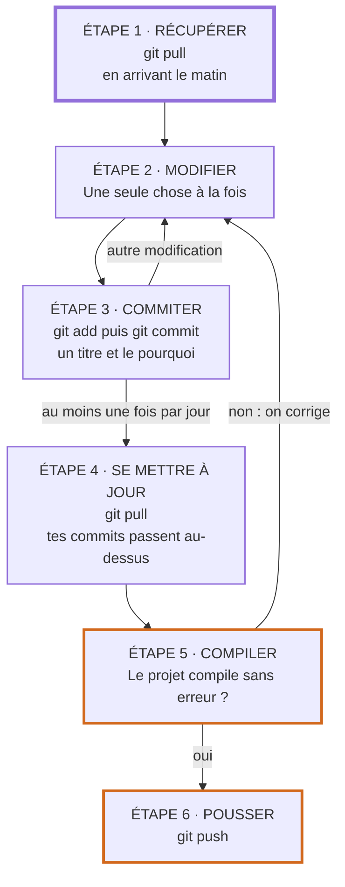
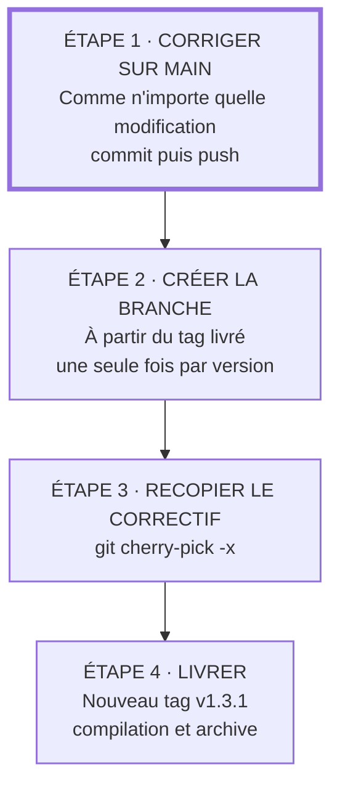

Bienvenue sur cette page où tu vas pouvoir mettre en place Git dans une équipe qui fait uniquement du firmware, avec un simple serveur Git et rien d'autre : pas de GitHub, pas de GitLab, pas de pull request, pas de serveur d'intégration continue.

L'objectif est d'avoir la méthode **la plus simple possible**, pour que toute l'équipe l'adopte réellement. Une méthode parfaite que personne n'applique vaut moins qu'une méthode simple appliquée par tous. Les justifications scientifiques de chaque règle sont détaillées dans la page [Bien travailler avec Git](../git/) : ici, on ne garde que ce qui sert au quotidien.

## Les 5 règles
Tout tient en cinq règles. On peut les imprimer et les coller à côté de l'écran.

1. **Tout le monde travaille sur `main`.** Pas de branche, sauf pour corriger une ancienne version déjà livrée.
2. **Un commit = une seule modification, et elle compile.** Si le titre du commit contient « et », c'est probablement deux commits.
3. **On pousse au moins une fois par jour.** Plus on attend, plus les conflits sont gros.
4. **On ne pousse jamais un `main` qui ne compile pas.** On compile juste avant chaque `git push`.
5. **Chaque firmware livré porte un tag.** Le numéro de version dans le binaire vient de Git, jamais d'une saisie à la main.

Pourquoi aucune branche par défaut ? Parce que sans outil de pull request, une branche n'apporte presque rien, et c'est justement la durée de vie des branches qui crée les conflits pénibles. Pour une petite équipe, travailler directement sur le tronc commun est une pratique reconnue (trunkbaseddevelopment.com). Les branches n'apparaissent qu'au moment où un client a besoin d'un correctif sur une ancienne version, et elles partent alors d'un tag.

## Mise en place
### Sur le serveur (une seule fois)
On crée un dépôt nu (« bare »), puis on interdit les deux opérations qui peuvent détruire le travail des autres : réécrire l'historique (`push --force`) et supprimer une branche ou un tag.

```bash
git init --bare /srv/git/mon_produit.git
cd /srv/git/mon_produit.git
git config receive.denyNonFastForwards true
git config receive.denyDeletes true
```

Ces deux réglages font partie de Git lui-même : aucun outil supplémentaire n'est nécessaire. Ils remplacent la « protection de branche » qu'offrent GitHub ou GitLab.

Chaque développeur se connecte en SSH avec sa propre clé :

```bash
git clone utilisateur@serveur:/srv/git/mon_produit.git
```

### Sur chaque poste (une seule fois)
```bash
git config --global user.name "Prénom Nom"
git config --global user.email "prenom.nom@entreprise.fr"
git config --global pull.rebase true
```

La dernière ligne évite les commits « Merge branch 'main' » à chaque récupération : tes commits sont simplement replacés au-dessus de ceux des collègues, et l'historique reste une ligne droite facile à lire.

### Dans le dépôt (une seule fois)
Deux fichiers à créer au premier commit.

Le `.gitignore`, qui exclut tout ce qui est généré par la compilation :

```text
# Sorties de compilation (STM32CubeIDE, CMake, ESP-IDF)
Debug/
Release/
build/

# ESP-IDF
sdkconfig.old
managed_components/
```

À l'inverse, **on versionne** tout ce qui sert à reconstruire le firmware à l'identique : le fichier `.ioc` de STM32CubeMX, le code généré (`Core/`, `Drivers/`), les fichiers de projet (`.project`, `.cproject`, `CMakeLists.txt`), et pour ESP-IDF le `sdkconfig` et le `dependencies.lock`.

Le `.gitattributes`, qui évite les fichiers entièrement modifiés juste parce qu'un collègue est sous Windows et l'autre sous Linux (fins de ligne différentes) :

```text
* text=auto
*.bin binary
*.hex binary
*.elf binary
```

## La journée de travail
Voici la boucle complète, à répéter pour chaque modification :



En commandes, cela donne :

```bash
git pull                    # le matin
# ... on modifie le code ...
git status                  # voir ce qui a changé
git add -p                  # choisir morceau par morceau ce qui entre dans le commit
git commit                  # écrire le message
git pull                    # avant de pousser
# ... on compile ...
git push
```

`git add -p` est la seule commande un peu inhabituelle : elle montre chaque morceau modifié et demande `y` (le garder) ou `n` (le laisser pour un autre commit). C'est elle qui permet de respecter la règle 2 quand on a touché à plusieurs sujets en même temps.

### Écrire le message
Une première ligne courte qui dit **ce qui** change, une ligne vide, puis **pourquoi**. Le pourquoi est la partie que tout le monde oublie, et c'est celle dont on a besoin six mois plus tard quand on cherche l'origine d'un bug.

```text
Vide le tampon UART avant le passage en mode STOP

Le microcontrôleur se réveillait en boucle quand un octet arrivait
pendant l'entrée en veille : l'interruption restait en attente.
```

Pour une petite correction évidente, la première ligne seule suffit.

### Quand `git pull` signale un conflit
C'est le seul moment un peu technique, et il devient rare quand on pousse tous les jours. Git s'arrête et indique les fichiers en conflit. Dans chacun, il a inséré les deux versions entre des marqueurs `<<<<<<<`, `=======` et `>>>>>>>`.

```bash
git status                  # liste les fichiers en conflit
# ... on ouvre chaque fichier, on garde la bonne version, on supprime les marqueurs ...
git add fichier_corrige.c
git rebase --continue
```

En cas de doute, on revient exactement à l'état d'avant le `git pull`, sans rien perdre, et on demande de l'aide au collègue qui a modifié le même fichier :

```bash
git rebase --abort
```

### Quand une fonctionnalité prend plusieurs jours
La règle 3 demande de pousser chaque jour, mais une fonctionnalité à moitié écrite ne doit pas perturber les autres. Deux solutions simples :

- **La découper** en étapes qui compilent et ne cassent rien : d'abord le pilote, puis le protocole, puis l'intégration.
- **La masquer à la compilation** tant qu'elle n'est pas terminée, avec un interrupteur qu'on supprime dès qu'elle est finie :

```c
#define FEATURE_BLE_OTA 0   // À retirer quand la mise à jour par Bluetooth est terminée

#if FEATURE_BLE_OTA
    ble_ota_init();
#endif
```

L'important est de **supprimer l'interrupteur** une fois la fonctionnalité terminée. Les interrupteurs oubliés deviennent du code mort que plus personne ne comprend.

### Faire relire sans outil de revue
Sans pull request, la relecture n'est pas imposée par l'outil. Pour une modification risquée (pilote d'alimentation, chargeur d'amorçage, sécurité), on demande à un collègue de regarder ses commits **avant** le `git push` :

```bash
git log -p origin/main..main    # affiche les commits pas encore poussés, avec leur contenu
```

Quinze minutes à deux devant l'écran suffisent. La relecture sert surtout à ce qu'au moins deux personnes connaissent chaque partie du code, plus qu'à trouver des bugs.

## Livrer un firmware
### Mettre la version dans le binaire
La règle 5 repose sur une commande : `git describe`. Elle produit une chaîne comme `v1.3.0-4-g2414721-dirty`, qui se lit ainsi :

- `v1.3.0` : le dernier tag.
- `4` : nombre de commits depuis ce tag.
- `g2414721` : l'identifiant du commit exact.
- `-dirty` : des modifications n'étaient pas commitées au moment de la compilation.

Un firmware livré doit afficher exactement le nom d'un tag, par exemple `v1.3.0`. Tout le reste signale une compilation de développement, et `-dirty` signale un binaire qu'on ne pourra jamais reconstruire.

Avec **ESP-IDF**, il n'y a rien à faire : si aucune version n'est définie dans le projet, ESP-IDF utilise `git describe` automatiquement, et la version se lit avec `esp_app_get_description()->version`.

Avec un projet **STM32 sous CMake**, on ajoute ces lignes au `CMakeLists.txt` :

```cmake
execute_process(
    COMMAND git describe --tags --dirty --always
    OUTPUT_VARIABLE FW_VERSION
    OUTPUT_STRIP_TRAILING_WHITESPACE
)
add_compile_definitions(FW_VERSION="${FW_VERSION}")
```

La chaîne `FW_VERSION` est alors utilisable partout dans le code, par exemple pour l'envoyer sur l'UART au démarrage. Attention : CMake ne la recalcule qu'à la configuration du projet, donc on relance une configuration propre avant de compiler une version à livrer.

### Le jour de la livraison
```bash
git pull
git tag -a v1.3.0 -m "Version 1.3.0"
git push origin v1.3.0
# ... compilation propre à partir de ce tag ...
```

On archive ensuite les fichiers `.elf`, `.bin` (ou `.hex`) et `.map` dans un dossier partagé nommé d'après le tag, par exemple `livraisons/v1.3.0/`. Les binaires ne vont **pas** dans Git : le tag suffit à les reconstruire, et le dossier d'archive permet de retrouver exactement ce qui a été flashé chez le client.

Pour choisir le numéro, on suit le versionnage sémantique : le dernier chiffre pour une correction (`v1.3.1`), celui du milieu pour une nouvelle fonctionnalité (`v1.4.0`), le premier quand une ancienne configuration ou un ancien protocole n'est plus compatible (`v2.0.0`).

### Corriger une version déjà chez le client
C'est le seul cas où l'on crée une branche. Un bug est trouvé sur des cartes en `v1.3.0`, alors que `main` contient déjà des nouveautés qu'on ne veut pas livrer.



```bash
# Étape 1 : le correctif est déjà poussé sur main, on note son identifiant
git log --oneline -5

# Étape 2 : branche à partir du tag livré (si elle n'existe pas encore)
git switch -c release/v1.3 v1.3.0

# Étape 3 : on recopie le correctif
git cherry-pick -x 2414721

# Étape 4 : on livre
git tag -a v1.3.1 -m "Version 1.3.1"
git push origin release/v1.3 v1.3.1

# Retour au travail normal
git switch main
```

La correction se fait **toujours d'abord sur `main`**, puis elle est recopiée vers l'ancienne version. Dans l'autre sens, on finit par oublier de la reporter et le bug revient dans la version suivante. L'option `-x` ajoute au message la référence du commit d'origine, ce qui permet de retrouver d'où vient chaque correctif.

## Ce qu'on ne fait pas, et pourquoi
- **Pas de `git push --force`.** Le serveur le refuse de toute façon, grâce au réglage de la mise en place.
- **Pas de mot de passe, clé de chiffrement ou clé de signature dans le dépôt.** Un secret commité reste dans l'historique de chaque clone, même après suppression du fichier. S'il est commité par erreur, on le considère comme compromis et on le change.
- **Pas de fichiers de CAO (PCB, mécanique) dans le dépôt du firmware.** Ce sont des fichiers binaires, qui ne se fusionnent pas et alourdissent chaque clone. Ils vont dans un dépôt séparé, et le firmware note dans un fichier texte la révision de carte qu'il vise.
- **Pas de copie de dossier `projet_v2_final_OK`.** Si on veut garder une ancienne version, c'est un tag.

## Quand cette méthode ne suffit plus
Cette page vise une équipe de quelques personnes. Quelques signaux indiquent qu'il est temps de passer à la méthode complète de la page [Bien travailler avec Git](../git/), avec un serveur comme Gitea ou GitLab :

- **`main` ne compile plus plusieurs fois par semaine** : il faut une compilation automatique sur le serveur à chaque `git push`.
- **On veut une relecture obligatoire et tracée**, par exemple pour une norme de sûreté (IEC 61508, ISO 26262, IEC 62304) : il faut des pull requests.
- **Les conflits deviennent fréquents malgré des pushs quotidiens** : l'équipe a grandi, et il faut des branches courtes avec relecture.

Tant qu'aucun de ces signaux n'apparaît, les 5 règles suffisent.

## Source
- Hammant P., *Trunk Based Development*, sections « Committing straight to the trunk » et « Branch for release » ([lire en ligne](https://trunkbaseddevelopment.com/)).

- Chacon S., Straub B., *Pro Git*, 2e édition, sections 3.6 « Rebasing », 4.2 « Getting Git on a Server », 5.2 « Contributing to a Project » ([lire en ligne](https://git-scm.com/book/fr/v2)).

- Documentation officielle de Git : *git-config* (`receive.denyNonFastForwards`, `receive.denyDeletes`, `pull.rebase`), *git-describe*, *git-cherry-pick*, *gitattributes*, *gitignore* ([lire en ligne](https://git-scm.com/docs/git-config)).

- Espressif, *Miscellaneous System APIs*, section « App Version », et *IDF Component Manager* ([lire en ligne](https://docs.espressif.com/projects/esp-idf/en/latest/esp32/api-reference/system/misc_system_api.html)).

- The Linux kernel documentation, *Everything you ever wanted to know about Linux -stable releases*, pour la règle « corriger d'abord sur le tronc » ([lire en ligne](https://docs.kernel.org/process/stable-kernel-rules.html)).

- *Semantic Versioning 2.0.0* ([lire en ligne](https://semver.org/lang/fr/)).

- Les autres références (études sur les conflits, la revue de code, les secrets, les normes de sûreté) sont listées dans la page [Bien travailler avec Git](../git/).
