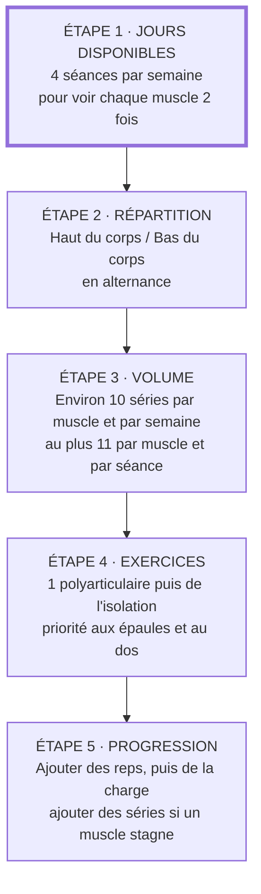

Cette page est pour ceux dont l'objectif est **d'être beau** : un physique musclé, sec et bien proportionné. Elle contient tout ce qu'il faut pour construire et suivre son programme.

Un physique esthétique repose sur trois choses :

- **Du muscle**, c'est-à-dire de l'hypertrophie. C'est le sujet de l'entraînement.
- **Un taux de gras bas**, pour que ce muscle se voie. C'est le sujet de l'alimentation, détaillé dans la page [plan repas](../meal_plan/).
- **Des proportions** : des épaules larges, un dos large, une taille fine. C'est le sujet du choix des exercices.

Comme pour la page force, chaque règle est accompagnée de sa source. Quand une règle vient de l'expérience des pratiquants plutôt que de la recherche, c'est indiqué.

## Force et esthétique : ce qui change
Les deux objectifs partagent la même base (s'entraîner régulièrement, augmenter progressivement la charge), mais la recherche montre qu'ils ne répondent pas aux mêmes leviers.

| Variable | Objectif force | Objectif esthétique | Source |
|---|---|---|---|
| **Charge** | Lourde, 80 % du 1RM ou plus (4 à 6 reps) | Indifférente dans une large zone : 6 à 30 reps donnent la même hypertrophie si les séries sont menées près de l'échec | ACSM 2026 ; Schoenfeld 2017 |
| **Volume** | Les gains plafonnent vite | Plus de séries, plus de muscle, avec des rendements décroissants | Pelland 2025 |
| **Échec** | Inutile de s'en approcher | S'en approcher (finir à 1 à 3 reps de l'échec), sans forcément l'atteindre | Robinson 2024 ; Refalo 2024 |
| **Fréquence** | Plus de séances par muscle aide | Effet négligeable à volume égal : elle sert à répartir le volume | Pelland 2025 ; Schoenfeld 2019 |
| **Exercices** | Peu de mouvements, toujours les mêmes | Plus de variété, dont de l'isolation, pour développer chaque muscle | Kassiano 2022 |

En résumé : **pour la force, on cherche à soulever lourd ; pour l'esthétique, on cherche à accumuler des séries difficiles.**

## Ce que la science établit pour l'hypertrophie
### Le volume, levier principal
Le nombre de séries par muscle et par semaine est le levier le plus documenté :

- Une première méta-analyse a montré que les gains augmentent avec le nombre de séries hebdomadaires (Schoenfeld 2017b).
- Chez des pratiquants entraînés, 5 séries par exercice ont donné plus de muscle que 3, et 3 plus que 1, alors que la force progressait autant dans les trois groupes (Schoenfeld 2019b).
- La méta-régression la plus complète à ce jour (67 études, 2 058 participants) confirme que l'hypertrophie augmente avec le volume hebdomadaire, avec des **rendements décroissants** : chaque série supplémentaire rapporte un peu moins que la précédente (Pelland 2025).

Le point de départ recommandé est d'environ **10 séries par groupe musculaire et par semaine** (ACSM 2026). On monte ensuite progressivement si un muscle ne progresse plus.

#### Compter ses séries
Un exercice ne travaille pas qu'un seul muscle : un développé couché sollicite aussi les triceps, un rowing les biceps. La méthode qui prédit le mieux l'hypertrophie compte **1 série pour le muscle visé et 0,5 série pour chaque muscle sollicité indirectement** (Pelland 2025). C'est cette méthode qu'utilise l'exemple de programme plus bas.

#### Par séance
Une analyse préliminaire des mêmes auteurs suggère qu'au-delà d'environ **11 séries pour un même muscle dans une séance**, les séries supplémentaires n'apportent plus de bénéfice détectable (Remmert 2025, prépublication non encore relue par des pairs). C'est la raison principale d'entraîner chaque muscle deux fois par semaine : répartir le volume plutôt que de le concentrer.

#### Le minimum et le maximum
Ce que la recherche dit de chaque zone de volume, en séries par muscle et par semaine :

| Volume hebdomadaire | Ce qu'on sait | Source |
|---|---|---|
| **Moins de 5 séries** | Ça marche déjà : environ 5 % de gain musculaire en moyenne dans les études, contre environ 10 % au-delà de 10 séries. Suffisant pour débuter ou pour maintenir. | Schoenfeld 2017b |
| **Environ 10 séries** | Le point de départ recommandé. | ACSM 2026 |
| **12 à 20 séries** | La zone la mieux documentée chez les pratiquants entraînés. En moyenne, aller au-delà de 20 n'a pas fait mieux pour les quadriceps et les biceps (mais mieux pour les triceps). | Baz-Valle 2022 |
| **20 à 30 séries** | Un gain supplémentaire reste possible, mais chaque série rapporte de moins en moins. | Pelland 2025 |
| **Plus de 30 séries** | Très peu de données, et elles se contredisent. Monter progressivement jusqu'à 52 séries pour les quadriceps a donné plus de muscle (Enes 2024). Multiplier le volume par 1,5 chez des athlètes déjà très entraînés n'a rien apporté, et a même légèrement freiné la force au soulevé de terre (Räntilä 2026). | Enes 2024 ; Räntilä 2026 |

**Peut-on trop s'entraîner pour le muscle ?** Dans les volumes étudiés, aucune étude ne montre que le muscle grossit *moins* avec plus de séries. Même une hausse brutale de 120 % du volume n'a pas freiné l'hypertrophie (Camargo 2026). Le « maximum » n'est donc pas un seuil au-delà duquel on régresse. C'est le point où **les séries en plus ne rapportent plus rien**, tout en coûtant du temps, de la fatigue et de l'usure articulaire. Ce point varie d'une personne à l'autre et d'un muscle à l'autre, et personne ne peut le prédire à l'avance.

Le vrai surentraînement (le syndrome où les performances chutent pendant des semaines malgré le repos) est surtout décrit chez les sportifs d'endurance. Le consensus européen et américain distingue la fatigue normale d'une période chargée, qui se résorbe en quelques jours de repos, de celle qui dure des semaines quand l'équilibre entre entraînement et récupération n'est pas respecté (Meeusen 2013).

#### Monter progressivement vers son maximum
Deux résultats guident la méthode :

- **Augmenter par petites étapes.** Chez des pratiquants entraînés, la jambe qui faisait 20 % de séries de plus qu'avant l'étude a plus grossi que celle qui suivait un volume standard de 22 séries, même quand ce volume standard était supérieur à leur habitude (Scarpelli 2022). Une hausse de 120 % ne fait pas mieux qu'une hausse de 20 % (Camargo 2026). Les grands sauts de volume ne servent donc à rien.
- **Ajouter régulièrement.** Ajouter 4 à 6 séries toutes les 2 semaines, à partir de 22, a donné plus de force et de muscle aux quadriceps en 12 semaines que de rester à 22 séries (Enes 2024).

La méthode qui en découle, à appliquer **muscle par muscle** :

1. **Commencer à environ 10 séries** par semaine (ACSM 2026). C'est le programme de cette page.
2. **Tant que le muscle progresse** (charges ou répétitions en hausse d'une semaine à l'autre), ne rien changer : inutile de payer plus cher ce qu'on obtient déjà.
3. **Quand il stagne** depuis 2 à 3 semaines alors que l'alimentation et le sommeil suivent, **ajouter environ 20 %**, soit 2 séries par semaine (Scarpelli 2022).
4. **Recommencer** à chaque stagnation : 10, puis 12, 14, 16… jusqu'à environ 20 séries, la zone la mieux documentée (Baz-Valle 2022).
5. **Au-delà de 20 séries**, ne monter que pour les muscles en retard, et en gardant au plus 11 séries par séance (Remmert 2025) : il faut alors une troisième séance par semaine pour ce muscle.
6. **Au-delà de 30 séries**, les données manquent : le bénéfice est incertain et le coût certain.

Signes qu'on a dépassé son maximum, à repérer dans le carnet de suivi : les charges ou les répétitions **baissent** pendant plus d'une semaine, les courbatures sont encore là à la séance suivante du même muscle, des douleurs articulaires apparaissent, le sommeil ou la motivation se dégradent. On fait alors une semaine allégée, puis on repart au dernier volume qui faisait progresser. Ces signes relèvent de l'expérience des entraîneurs : la recherche ne fournit pas encore de marqueur fiable du surentraînement (Meeusen 2013).

### La charge et les répétitions
Charges lourdes et charges légères donnent une hypertrophie similaire, à condition de mener les séries près de l'échec (Schoenfeld 2017). On a donc le choix. En pratique :

- **6 à 10 reps sur les exercices polyarticulaires** (squat, développés, rowings) : assez lourd pour progresser en charge, assez léger pour enchaîner plusieurs séries.
- **10 à 20 reps sur les exercices d'isolation** (élévations latérales, curls, mollets) : ces exercices se prêtent mal aux charges très lourdes.

Ces fourchettes sont un choix pratique à l'intérieur de la zone validée, pas une obligation.

### La proximité de l'échec
Il faut distinguer **s'approcher de l'échec** et **aller jusqu'à l'échec** :

- **S'approcher de l'échec compte.** Une série arrêtée à 5 ou 6 répétitions de l'échec fait moins grossir le muscle qu'une série arrêtée à 1 ou 2 répétitions. Pour la force, cette distance ne change presque rien (Robinson 2024).
- **Atteindre l'échec n'apporte rien de plus.** Une méta-analyse ne trouve pas de différence d'hypertrophie entre séries menées à l'échec et séries arrêtées juste avant (Refalo 2023). Chez des pratiquants entraînés, aller à l'échec ou s'arrêter à 1 à 2 répétitions a donné la même hypertrophie en 8 semaines, mais l'échec a provoqué plus de fatigue (Refalo 2024). L'ACSM ne le juge pas nécessaire non plus (ACSM 2026).

L'objectif est donc que chaque série soit **difficile**, pas qu'elle se termine par une répétition ratée.

Règle pratique : finir à **1 à 3 répétitions de l'échec sur les exercices polyarticulaires**, où rater une répétition est risqué et fatigue beaucoup. Sur l'isolation (élévations latérales, curls, mollets), on peut aller jusqu'à **0 ou 1 répétition de l'échec**, parce que c'est sans danger. C'est aussi là qu'on se trompe le plus en s'arrêtant trop tôt.

### Le repos entre les séries
Reposer plus de 60 secondes donne un léger avantage pour l'hypertrophie, sans gain supplémentaire au-delà de 90 secondes (Singer 2024). Chez des pratiquants entraînés, 3 minutes ont donné plus de muscle qu'une minute (Schoenfeld 2016).

Règle pratique : **2 à 3 minutes sur les polyarticulaires, 1 à 2 minutes sur l'isolation**. Le repos sert à refaire le même nombre de répétitions à la série suivante.

### La fréquence
À volume égal, entraîner un muscle une ou plusieurs fois par semaine donne une hypertrophie comparable (Schoenfeld 2019 ; Pelland 2025). Le plancher recommandé reste de **2 fois par semaine** par groupe musculaire (OMS 2020 ; ACSM 2026), et c'est ce qui permet de garder des séances raisonnables quand le volume monte.

### Le choix des exercices
- **Varier, mais pas trop.** Choisir des exercices complémentaires (par exemple un mouvement où le muscle est étiré et un autre où il est contracté) favorise le développement de toutes les régions d'un muscle. En revanche, changer d'exercices trop souvent ou empiler des exercices redondants freine les progrès (Kassiano 2022). On garde donc les mêmes exercices plusieurs semaines pour pouvoir y progresser.
- **Machines, poulies et poids libres se valent** pour l'hypertrophie (Haugen 2023 ; ACSM 2026). Les machines et poulies sont même pratiques pour l'isolation, où elles permettent d'aller près de l'échec en sécurité.

### L'amplitude
Travailler en amplitude complète donne un peu plus de muscle que les demi-mouvements (Wolf 2023). Des études récentes suggèrent que la partie du mouvement où le muscle est **étiré** serait la plus productive, mais les données sont encore trop peu nombreuses pour en faire une règle (Wolf 2023). Règle prudente : **amplitude complète, en contrôlant bien la position étirée**.

### Le tempo
Des répétitions de 0,5 à 8 secondes donnent la même hypertrophie ; seules les répétitions volontairement très lentes (plus de 10 secondes) sont moins efficaces (Schoenfeld 2015). Inutile de compter : il suffit de contrôler la descente.

### La progression
On utilise la progression « double » : on reste à la même charge en ajoutant des répétitions jusqu'au haut de la fourchette (10 reps sur une fourchette 6-10, par exemple), puis on augmente la charge de **2 à 10 %** et on repart du bas de la fourchette (ACSM 2009).

### L'échauffement
Avant le premier exercice polyarticulaire de la séance, monter progressivement en charge :

- 10-12 reps à 50 % de la charge de travail
- 1 min de repos
- 4-6 reps à 70 % de la charge
- 1 min de repos
- 1-2 reps à 90 % de la charge
- 2 min de repos, puis première série de travail

Pour les exercices suivants, une série légère suffit, le corps étant déjà chaud. Cette montée en charge est une pratique d'entraîneurs : elle n'a pas été comparée en étude contrôlée, mais elle n'est pas contredite.

### Le cardio
Faire du cardio en plus de la musculation **ne freine ni l'hypertrophie ni la force maximale**. Seule la force explosive (sauts, sprints) en pâtit un peu quand les deux sont faits dans la même séance, et l'effet disparaît quand on les sépare d'au moins 3 heures (Schumann 2022). Si c'est impossible, commencer par la musculation.

Le cardio est aussi utile pour l'esthétique : il augmente la dépense énergétique, ce qui facilite la sèche. Côté santé, l'OMS recommande **150 à 300 minutes d'activité d'endurance modérée par semaine, ou 75 à 150 minutes d'activité intense** (OMS 2020). Par exemple : 2 à 3 séances de 25 minutes de fractionné, ou 3 à 5 séances de 30 à 60 minutes de marche rapide ou de vélo.

### La prévention des blessures
La musculation elle-même protège : les programmes de renforcement réduisent le risque de blessure sportive à **environ un tiers** de celui des groupes témoins (Lauersen 2018). Les deux règles qui limitent le risque dans la salle sont déjà dans cette page : s'arrêter à 1 à 3 répétitions de l'échec sur les mouvements lourds, et augmenter les charges par petites étapes.

### La décompression
Une semaine d'arrêt complet au milieu d'un programme de 9 semaines n'a fait perdre aucun muscle, mais a légèrement pénalisé la force du bas du corps (Coleman 2024). Une semaine allégée (moitié moins de séries, charges réduites) toutes les 6 à 10 semaines, ou quand la fatigue s'accumule, est donc sans risque pour l'esthétique. Le rythme exact relève de l'expérience des entraîneurs, pas encore d'études contrôlées (Bell 2023).

## Le plaisir, condition de la régularité
Le meilleur programme est celui que l'on tient : c'est le message central de l'ACSM, qui place les objectifs personnels et le **plaisir** au cœur de la prescription (ACSM 2026). Une revue des facteurs liés à la pratique de la musculation retrouve le même résultat : le ressenti positif de l'entraînement fait partie des facteurs associés au fait de continuer (Rhodes 2017).

Bonne nouvelle : pour l'hypertrophie, la plupart des choix qui rendent l'entraînement agréable ne coûtent rien en résultats.

### Ce que la recherche montre
- **Choisir ses exercices ne coûte rien.** Machines, poulies et poids libres donnent les mêmes résultats (Haugen 2023), et le choix des exercices fait partie des variables « flexibles » à adapter à ses préférences (ACSM 2026).
- **Varier motive.** Des pratiquants dont les exercices changeaient à chaque séance ont gagné en motivation, avec la même prise de force et de muscle que le groupe qui gardait toujours les mêmes exercices (Baz-Valle 2019). Attention cependant : changer trop souvent empêche de mesurer ses progrès, et peut freiner certains gains (Kassiano 2022).
- **S'arrêter avant l'échec est plus agréable.** Comparé à des séries arrêtées 1 à 2 répétitions avant, l'entraînement à l'échec est vécu comme nettement plus désagréable, et l'écart se creuse au fil des semaines (Refalo 2025). Or il n'apporte pas plus de muscle (Refalo 2024).

### Les exercices les plus pratiqués
Aucune étude ne classe les exercices selon le plaisir qu'ils procurent. Le meilleur indicateur disponible est ce que les pratiquants choisissent de faire. Voici les exercices les plus enregistrés par les hommes dans une application de suivi utilisée par plus de 700 000 personnes, en part du total des séries (StrengthLog 2025) :

| Rang | Exercice | Part des séries |
|---|---|---|
| 1 | Développé couché | 10,7 % |
| 2 | Squat | 6,7 % |
| 3 | Soulevé de terre | 4,8 % |
| 4 | Tirage poitrine | 3,6 % |
| 5 | Développé militaire | 3,5 % |
| 6 | Rowing à la barre | 3,2 % |
| 7 | Élévations latérales avec haltères | 2,8 % |
| 8 | Leg extension | 2,4 % |
| 9 | Curl à la barre | 2,4 % |
| 10 | Extension des triceps à la poulie | 2,1 % |

Ce n'est pas une mesure du plaisir : un exercice peut être fait souvent parce qu'il est classique ou parce que le matériel est disponible. Mais un exercice que des centaines de milliers de personnes choisissent librement a peu de chances d'être une corvée.

### Le menu d'exercices
Pour mettre le plaisir dans le programme, chaque exercice peut être remplacé par un autre **de la même ligne** : ils travaillent les mêmes muscles de la même façon, et la recherche ne les départage pas pour l'hypertrophie.

| Emplacement | Exercices interchangeables |
|---|---|
| Pectoraux, développé | Développé couché ou incliné (barre, haltères, machine), dips, pompes lestées |
| Pectoraux, écartés | Écartés à la poulie, pec deck, écartés avec haltères |
| Dos, tirage vertical | Tractions, tirage poitrine, tirage unilatéral à la poulie |
| Dos, tirage horizontal | Rowing barre, haltère, poulie assis, machine, barre T |
| Épaules, développé | Développé militaire (barre, haltères, machine), développé Arnold |
| Deltoïdes latéraux | Élévations latérales (haltères, poulie, machine) |
| Deltoïdes postérieurs | Face Pull, élévations postérieures, pec deck inversé |
| Biceps | Curl barre, barre E-Z, haltères, marteau, poulie, incliné |
| Triceps | Extension à la poulie (barre, corde), extension au-dessus de la tête, Skullcrusher, développé prise serrée |
| Quadriceps | Squat, Hack Squat, presse à cuisses, fentes, leg extension |
| Ischio-jambiers | Soulevé de terre roumain, Leg Curl allongé ou assis |
| Mollets | Élévations mollets debout, assis, à la presse |
| Abdominaux | Crunch à la poulie, relevé de jambes, roue abdominale |

Règles pour garder les bénéfices de la variété sans ses inconvénients :

1. **Prendre dans chaque ligne les exercices que l'on aime**, et écarter ceux qu'on redoute : une série faite avec envie vaut mieux qu'une série bâclée.
2. **Garder les mêmes exercices pendant un cycle** (4 à 8 semaines), pour pouvoir y progresser et mesurer ses progrès (Kassiano 2022).
3. **Changer un ou deux exercices à chaque nouveau cycle**, pour la motivation (Baz-Valle 2019).
4. **Remplacer sans culpabiliser** un exercice quand la machine est prise ou que l'envie n'y est pas, par un exercice de la même ligne.

## Les proportions
Cette partie relève du **savoir des pratiquants** (culturistes, entraîneurs) : elle n'est pas étudiée scientifiquement, mais elle n'est pas contredite non plus.

Ce qui donne l'impression d'un physique « esthétique » est surtout la **forme en V** : des épaules et un dos larges au-dessus d'une taille fine. Les muscles à prioriser sont donc :

- **Les deltoïdes latéraux** (élévations latérales) : ce sont eux qui élargissent les épaules, et les développés les sollicitent peu.
- **Le grand dorsal** (tractions, tirages verticaux) : il élargit le dos.
- **Les deltoïdes postérieurs** (face pull, élévations postérieures) : ils donnent de l'épaisseur aux épaules vues de côté et de dos.
- **Le haut des pectoraux** (développé incliné).
- **Les bras et les mollets**, visibles en t-shirt et en short, et souvent négligés par les programmes de force.

La taille, elle, s'affine surtout en baissant le taux de gras.

## L'alimentation pour l'esthétique
Les calculs détaillés sont dans la page [plan repas](../meal_plan/). Ce qui est spécifique à l'objectif esthétique :

- **Prise de masse** : un surplus modeste, d'environ **10 à 20 % au-dessus de la dépense** pour un débutant ou un intermédiaire, en visant une prise de poids de **0,25 à 0,5 % du poids de corps par semaine**. Les pratiquants avancés doivent être plus prudents encore (Iraki 2019). Au-delà, on stocke surtout du gras, qu'il faudra ensuite perdre.
- **Sèche** : viser une perte de **0,5 à 1 % du poids de corps par semaine** pour préserver le muscle (Helms 2014). Une perte plus rapide augmente le risque de perdre du muscle.
- **Protéines** : les gains de masse musculaire n'augmentent plus au-delà d'environ **1,6 g/kg/jour** (Morton 2018) ; les recommandations pour les culturistes vont de 1,6 à 2,2 g/kg/jour en prise de masse (Iraki 2019).
- **Créatine** : la créatine monohydrate est le complément le mieux étudié pour augmenter la masse musculaire, et elle est considérée comme sûre chez l'adulte en bonne santé (Kreider 2017). Dose habituelle : 3 à 5 g par jour, en continu.

Pour suivre l'évolution du poids d'une semaine à l'autre, voir la page [suivre ses progrès](../tracking/).

## Construire son programme
Voici le chemin, des jours disponibles à la séance :



### Exemple : Haut / Bas sur 4 jours
Chaque muscle est travaillé deux fois par semaine. Dans chaque séance, les exercices polyarticulaires passent en premier, quand on est le plus frais. Chaque exercice peut être remplacé par un autre de la même ligne du [menu d'exercices](#le-menu-dexercices).

#### Jour 1 : Haut A
- Développé incliné avec haltères : 4 séries de 6-10 reps
- Rowing à la barre : 3 séries de 6-10 reps
- Développé militaire assis avec haltères : 3 séries de 8-12 reps
- Tirage poitrine prise large : 3 séries de 8-12 reps
- Élévations latérales avec haltères : 4 séries de 12-20 reps
- Curl avec haltères : 2 séries de 10-15 reps
- Extension des triceps à la poulie : 2 séries de 10-15 reps

#### Jour 2 : Bas A
- Squat : 3 séries de 6-10 reps
- Soulevé de terre roumain : 3 séries de 8-12 reps
- Presse à cuisses : 2 séries de 10-15 reps
- Leg Curl allongé : 3 séries de 10-15 reps
- Élévations mollets debout : 5 séries de 10-15 reps
- Crunch à la poulie : 3 séries de 10-15 reps

#### Jour 3 : repos

#### Jour 4 : Haut B
- Développé couché : 3 séries de 6-10 reps
- Tractions : 3 séries de 6-10 reps
- Écartés à la poulie : 3 séries de 10-15 reps
- Rowing haltère unilatéral : 2 séries de 8-12 reps
- Élévations latérales à la poulie : 4 séries de 12-20 reps
- Face Pull : 3 séries de 12-20 reps
- Curl incliné avec haltères : 2 séries de 10-15 reps
- Extension des triceps au-dessus de la tête : 2 séries de 10-15 reps

#### Jour 5 : Bas B
- Hack Squat : 3 séries de 8-12 reps
- Fentes avec haltères : 2 séries de 8-12 reps par jambe
- Leg Curl assis : 3 séries de 10-15 reps
- Leg extension : 2 séries de 12-15 reps
- Élévations mollets assis : 5 séries de 12-20 reps
- Relevé de jambes en suspension : 3 séries jusqu'à 1 rep de l'échec

#### Jours 6 et 7 : repos

### Vérification du volume
On compte 1 série pour le muscle visé et 0,5 pour un muscle sollicité indirectement (Pelland 2025) :

| Muscle | Séries directes | Séries indirectes (x 0,5) | Total par semaine |
|---|---|---|---|
| Pectoraux | 4 + 3 + 3 = 10 | | **10** |
| Dos | 3 + 3 + 3 + 2 = 11 | | **11** |
| Deltoïdes latéraux | 4 + 4 = 8 | développé militaire : 3 | **9,5** |
| Deltoïdes postérieurs | 3 | rowings et tirages : 11 | **8,5** |
| Biceps | 2 + 2 = 4 | rowings, tirages, tractions : 11 | **9,5** |
| Triceps | 2 + 2 = 4 | développés : 4 + 3 + 3 + 3 = 13 | **10,5** |
| Quadriceps | 3 + 2 + 3 + 2 + 2 = 12 | | **12** |
| Ischio-jambiers | 3 + 3 + 3 = 9 | squat, fentes : 5 | **11,5** |
| Mollets | 5 + 5 = 10 | | **10** |
| Abdominaux | 3 + 3 = 6 | | **6** |

Chaque grand groupe tourne autour des 10 séries hebdomadaires, et aucun ne dépasse 11 séries dans une même séance. Les séances comptent 18 à 22 séries, soit 60 à 80 minutes avec les temps de repos.

### Variante : le format libre
Un programme figé n'est pas obligatoire. On peut arriver à la salle et choisir ses exercices à l'instinct, selon l'envie, la forme du jour et les machines libres.

**Ce que dit la recherche :**

- Des débutants qui choisissaient chaque jour leur séance selon leur forme ont progressé autant au développé, et plus à la presse à cuisses, que ceux qui suivaient un ordre imposé (McNamara 2010).
- Chez des pratiquants entraînés, laisser choisir l'ordre des séances a donné les mêmes progrès qu'un ordre fixe (Colquhoun 2017).
- Changer d'exercices à chaque séance a augmenté la motivation, avec les mêmes gains (Baz-Valle 2019).

Les deux seuls risques sont **d'oublier des muscles** (on fait toujours ce qu'on préfère) et **de ne plus pouvoir mesurer ses progrès** (on ne refait jamais deux fois le même exercice : Kassiano 2022). D'où le principe des cartes de séance : **les muscles du jour et le nombre de séries sont fixés, le choix des exercices est libre**.

#### Les cartes de séance
Il n'y a que deux cartes, chacune faite deux fois par semaine (par exemple Haut le lundi et le jeudi, Bas le mardi et le vendredi). Chaque ligne est un emplacement : on y fait le nombre de séries indiqué avec **l'exercice de son choix parmi ceux proposés**, en changeant quand on veut. Seul l'emplacement 1 se fait en premier ; l'ordre des autres est libre.

```text
CARTE HAUT (2 fois par semaine)
1. Gros développé ........ 4 séries x 6-10
   développé couché, incliné (barre ou haltères), machine, dips
2. Gros tirage ........... 3 séries x 6-10
   tractions, tirage poitrine, rowing barre, rowing haltère
3. Second tirage ......... 3 séries x 8-12
   l'autre direction que le 2 : vertical si le 2 était horizontal, et inversement
4. Pecs ou épaules ....... 3 séries x 8-15
   développé militaire (barre, haltères, machine), écartés poulie, pec deck
5. Largeur d'épaules ..... 4 séries x 12-20
   élévations latérales (haltères, poulie, machine)
6. Bras .................. 2 séries biceps + 2 séries triceps x 10-15
   curl (barre, haltères, marteau, incliné, poulie)
   extension triceps (poulie, au-dessus de la tête, skullcrusher)

CARTE BAS (2 fois par semaine)
1. Gros exercice cuisses .. 3 séries x 6-10
   squat, hack squat, presse à cuisses
2. Charnière de hanche .... 3 séries x 8-12
   soulevé de terre roumain, leg curl
3. Cuisses, complément .... 2 séries x 10-15
   fentes, leg extension, presse
4. Ischios, complément .... 2 séries x 10-15
   leg curl (allongé ou assis)
5. Mollets ................ 5 séries x 10-20
   élévations debout, assis, à la presse
6. Abdos .................. 3 séries
   crunch poulie, relevé de jambes, roue abdominale
```

Sur la semaine, ces cartes donnent environ 10 à 12 séries par grand groupe musculaire, en comptant à moitié les séries indirectes (Pelland 2025), sans dépasser 11 séries par muscle et par séance (Remmert 2025). Les listes reprennent le [menu d'exercices](#le-menu-dexercices), où l'on peut piocher d'autres options de la même ligne.

#### Les règles qui ne bougent pas
Le format est libre, mais ces règles restent les mêmes, parce que c'est d'elles que viennent les résultats :

- **Échauffement** avant le premier gros exercice.
- **Séries difficiles** : finir à 1 à 3 répétitions de l'échec (0 à 1 sur l'isolation).
- **Repos** de 2 à 3 minutes sur les gros exercices, 1 à 2 minutes sur l'isolation.
- **Progression** : sur un exercice déjà fait, viser une répétition ou un peu de charge de plus que la dernière fois.

#### Les exercices repères
Pour l'emplacement 1 de chaque carte, choisir **un exercice favori à refaire au moins une fois par semaine**, par exemple le développé incliné pour la carte Haut ou le squat pour la carte Bas. C'est sur lui qu'on suit les progrès dans le carnet. Tout le reste peut changer librement.

Pour noter ses séances, il suffit d'écrire l'exercice choisi en face de chaque emplacement, avec charges et répétitions.

### Faire évoluer le programme
- **Un muscle progresse** (les charges montent, les mensurations aussi) : ne rien changer.
- **Un muscle stagne** depuis 2 à 3 semaines alors que l'alimentation et le sommeil suivent : ajouter environ 20 % de séries, soit 2 par semaine pour ce muscle, en les répartissant sur les deux séances (voir [monter progressivement vers son maximum](#monter-progressivement-vers-son-maximum)).
- **Un muscle est en retard visuellement** : le travailler en début de séance, quand on est frais.
- **La fatigue s'accumule** (charges en baisse, articulations douloureuses) : faire une semaine allégée.

### Un muscle déjà en avance
Un passé sportif laisse souvent un groupe musculaire très développé : les cuisses et les mollets d'un ancien cycliste ou coureur, les épaules d'un ancien nageur. Pour l'esthétique, inutile de le faire grossir encore : on le passe en **volume de maintien**, et on redonne le temps gagné aux muscles en retard.

Le maintien demande très peu :

- Après 16 semaines d'entraînement, des adultes jeunes ont **gardé leur muscle pendant 32 semaines avec un neuvième du volume initial**. Les adultes plus âgés, eux, ne l'ont pas gardé à cette dose (Bickel 2011).
- Une revue de la littérature conclut que force et masse musculaire se maintiennent, chez les jeunes, avec **1 séance par semaine et 1 série par exercice**, à condition de garder des charges lourdes. Chez les plus âgés, il faut jusqu'à 2 séances et 2 à 3 séries par exercice (Spiering 2021).

Règle pratique pour un adulte jeune : **2 à 4 séries par semaine** pour le groupe en avance, sur un ou deux exercices, avec des charges aussi lourdes que d'habitude. Plus âgé, compter le double. Si l'on pratique encore le sport d'origine (vélo, course), il contribue aussi au maintien.

Ne jamais supprimer complètement un groupe : on garde un peu de travail pour l'équilibre et la santé des articulations, et le minimum recommandé pour la santé reste de travailler tous les grands groupes musculaires au moins deux fois par semaine (OMS 2020).

## Source
- Phillips SM, Currier BS, D'Souza AC, Fiatarone Singh MA, Lowisz CV, Rawson ES, Schoenfeld BJ, Smith-Ryan AE, Steen JP, Thomas GA, Triplett NT, Washington TA, Werner TJ (ACSM 2026), *American College of Sports Medicine Position Stand. Resistance Training Prescription for Muscle Function, Hypertrophy, and Physical Performance in Healthy Adults: An Overview of Reviews*, Medicine & Science in Sports & Exercise, 58(4), p. 851-872, avril 2026 ([doi:10.1249/MSS.0000000000003897](https://doi.org/10.1249/MSS.0000000000003897) ; [communiqué de l'ACSM](https://www.newswise.com/articles/acsm-unveils-landmark-2026-resistance-training-guidelines-first-update-in-17-years)).

- American College of Sports Medicine (ACSM 2009), *Progression Models in Resistance Training for Healthy Adults*, Medicine & Science in Sports & Exercise, 41(3), p. 687-708, 2009 ([doi:10.1249/MSS.0b013e3181915670](https://doi.org/10.1249/MSS.0b013e3181915670)).

- Bull FC et al. (OMS 2020), *World Health Organization 2020 guidelines on physical activity and sedentary behaviour*, British Journal of Sports Medicine, 54(24), p. 1451-1462, 2020 ([doi:10.1136/bjsports-2020-102955](https://doi.org/10.1136/bjsports-2020-102955)).

- Pelland JC, Remmert JF, Robinson ZP, Hinson SR, Zourdos MC (Pelland 2025), *The Resistance Training Dose Response: Meta-Regressions Exploring the Effects of Weekly Volume and Frequency on Muscle Hypertrophy and Strength Gains*, Sports Medicine, 56(2), p. 481-505, 2026, publié en ligne en décembre 2025 ([doi:10.1007/s40279-025-02344-w](https://doi.org/10.1007/s40279-025-02344-w)). Source du comptage en demi-séries et des rendements décroissants du volume.

- Remmert JF, Pelland JC, Robinson ZP, Hinson SR, Zourdos MC (Remmert 2025), *Is There Too Much of a Good Thing? Meta-Regressions of the Effect of Per-Session Volume on Hypertrophy and Strength*, SportRxiv, prépublication, 2025 ([doi:10.51224/SRXIV.537](https://doi.org/10.51224/SRXIV.537)).

- Schoenfeld BJ, Ogborn D, Krieger JW (Schoenfeld 2017b), *Dose-response relationship between weekly resistance training volume and increases in muscle mass: A systematic review and meta-analysis*, Journal of Sports Sciences, 35(11), p. 1073-1082, 2017 ([doi:10.1080/02640414.2016.1210197](https://doi.org/10.1080/02640414.2016.1210197)).

- Baz-Valle E, Balsalobre-Fernández C, Alix-Fages C, Santos-Concejero J (Baz-Valle 2022), *A Systematic Review of the Effects of Different Resistance Training Volumes on Muscle Hypertrophy*, Journal of Human Kinetics, 81, p. 199-210, 2022 ([doi:10.2478/hukin-2022-0017](https://doi.org/10.2478/hukin-2022-0017)).

- Enes A, De Souza EO, Souza-Junior TP (Enes 2024), *Effects of Different Weekly Set Progressions on Muscular Adaptations in Trained Males: Is There a Dose-Response Effect?*, Medicine & Science in Sports & Exercise, 56(3), p. 553-563, 2024 ([doi:10.1249/MSS.0000000000003317](https://doi.org/10.1249/MSS.0000000000003317)).

- Räntilä A, Ahtiainen JP (Räntilä 2026), *Exploring the Upper Limits of Resistance Training Volume for Muscle Hypertrophy and Strength in Trained Athletes*, Journal of Science in Sport and Exercise, 2026 ([doi:10.1007/s42978-026-00387-7](https://doi.org/10.1007/s42978-026-00387-7)).

- Camargo J, Bittencourt D, Michel J, Silva D, Bergamasco J, Tiede D, Lewis D, Nacafucasaco E, Ferrari O, Melo A, Iasulaitis M, Rebelato M, Roberts M, Libardi C (Camargo 2026), *Large increases in resistance training volume do not impair muscle hypertrophy or anabolic-catabolic molecular signaling in trained individuals*, Journal of Applied Physiology, 141(2), p. 477-493, 2026 ([doi:10.1152/japplphysiol.00284.2026](https://doi.org/10.1152/japplphysiol.00284.2026)).

- Scarpelli MC, Nóbrega SR, Santanielo N, Alvarez IF, Otoboni GB, Ugrinowitsch C, Libardi CA (Scarpelli 2022), *Muscle Hypertrophy Response Is Affected by Previous Resistance Training Volume in Trained Individuals*, Journal of Strength and Conditioning Research, 36(4), p. 1153-1157, 2022 ([doi:10.1519/JSC.0000000000003558](https://doi.org/10.1519/JSC.0000000000003558)).

- Rhodes RE, Lubans DR, Karunamuni N, Kennedy S, Plotnikoff R (Rhodes 2017), *Factors associated with participation in resistance training: a systematic review*, British Journal of Sports Medicine, 51(20), p. 1466-1472, 2017 ([doi:10.1136/bjsports-2016-096950](https://doi.org/10.1136/bjsports-2016-096950)).

- Baz-Valle E, Schoenfeld BJ, Torres-Unda J, Santos-Concejero J, Balsalobre-Fernández C (Baz-Valle 2019), *The effects of exercise variation in muscle thickness, maximal strength and motivation in resistance trained men*, PLOS ONE, 14(12), e0226989, 2019 ([doi:10.1371/journal.pone.0226989](https://doi.org/10.1371/journal.pone.0226989)).

- Refalo MC, Helms ER, Hamilton DL, Fyfe JJ (Refalo 2025), *The Effect of Proximity-To-Failure on Perceptual Responses to Resistance Training*, European Journal of Sport Science, 25(3), e12266, 2025 ([doi:10.1002/ejsc.12266](https://doi.org/10.1002/ejsc.12266)).

- StrengthLog (StrengthLog 2025), *The Most Popular Gym Exercises for Men & Women in 2025*, novembre 2025 ([lire en ligne](https://www.strengthlog.com/most-popular-exercises/)). Données d'usage d'une application de suivi, pas une étude scientifique.

- McNamara JM, Stearne DJ (McNamara 2010), *Flexible Nonlinear Periodization in a Beginner College Weight Training Class*, Journal of Strength and Conditioning Research, 24(1), p. 17-22, 2010 ([doi:10.1519/JSC.0b013e3181bc177b](https://doi.org/10.1519/JSC.0b013e3181bc177b)).

- Colquhoun RJ, Gai CM, Walters J, Brannon AR, Kilpatrick MW, D'Agostino DP, Campbell BI (Colquhoun 2017), *Comparison of Powerlifting Performance in Trained Men Using Traditional and Flexible Daily Undulating Periodization*, Journal of Strength and Conditioning Research, 31(2), p. 283-291, 2017 ([doi:10.1519/JSC.0000000000001500](https://doi.org/10.1519/JSC.0000000000001500)).

- Bickel CS, Cross JM, Bamman MM (Bickel 2011), *Exercise Dosing to Retain Resistance Training Adaptations in Young and Older Adults*, Medicine & Science in Sports & Exercise, 43(7), p. 1177-1187, 2011 ([doi:10.1249/MSS.0b013e318207c15d](https://doi.org/10.1249/MSS.0b013e318207c15d)).

- Spiering BA, Mujika I, Sharp MA, Foulis SA (Spiering 2021), *Maintaining Physical Performance: The Minimal Dose of Exercise Needed to Preserve Endurance and Strength Over Time*, Journal of Strength and Conditioning Research, 35(5), p. 1449-1458, 2021 ([doi:10.1519/JSC.0000000000003964](https://doi.org/10.1519/JSC.0000000000003964)).

- Meeusen R, Duclos M, Foster C, Fry A, Gleeson M, Nieman D, Raglin J, Rietjens G, Steinacker J, Urhausen A (Meeusen 2013), *Prevention, diagnosis, and treatment of the overtraining syndrome: joint consensus statement of the European College of Sport Science and the American College of Sports Medicine*, Medicine & Science in Sports & Exercise, 45(1), p. 186-205, 2013 ([doi:10.1249/MSS.0b013e318279a10a](https://doi.org/10.1249/MSS.0b013e318279a10a)).

- Schoenfeld BJ, Contreras B, Krieger J, Grgic J, Delcastillo K, Belliard R, Alto A (Schoenfeld 2019b), *Resistance Training Volume Enhances Muscle Hypertrophy but Not Strength in Trained Men*, Medicine & Science in Sports & Exercise, 51(1), p. 94-103, 2019 ([doi:10.1249/MSS.0000000000001764](https://doi.org/10.1249/MSS.0000000000001764)).

- Schoenfeld BJ, Grgic J, Ogborn D, Krieger JW (Schoenfeld 2017), *Strength and Hypertrophy Adaptations Between Low- vs. High-Load Resistance Training: A Systematic Review and Meta-analysis*, Journal of Strength and Conditioning Research, 31(12), p. 3508-3523, 2017 ([doi:10.1519/JSC.0000000000002200](https://doi.org/10.1519/JSC.0000000000002200)).

- Robinson ZP, Pelland JC, Remmert JF, Refalo MC, Jukic I, Steele J, Zourdos MC (Robinson 2024), *Exploring the Dose-Response Relationship Between Estimated Resistance Training Proximity to Failure, Strength Gain, and Muscle Hypertrophy: A Series of Meta-Regressions*, Sports Medicine, 54(9), p. 2209-2231, 2024 ([doi:10.1007/s40279-024-02069-2](https://doi.org/10.1007/s40279-024-02069-2)).

- Refalo MC, Helms ER, Trexler ET, Hamilton DL, Fyfe JJ (Refalo 2023), *Influence of Resistance Training Proximity-to-Failure on Skeletal Muscle Hypertrophy: A Systematic Review with Meta-analysis*, Sports Medicine, 53(3), p. 649-665, 2023 ([doi:10.1007/s40279-022-01784-y](https://doi.org/10.1007/s40279-022-01784-y)).

- Refalo MC, Helms ER, Robinson ZP, Hamilton DL, Fyfe JJ (Refalo 2024), *Similar muscle hypertrophy following eight weeks of resistance training to momentary muscular failure or with repetitions-in-reserve in resistance-trained individuals*, Journal of Sports Sciences, 42(1), p. 85-101, 2024 ([doi:10.1080/02640414.2024.2321021](https://doi.org/10.1080/02640414.2024.2321021)).

- Schoenfeld BJ, Grgic J, Krieger J (Schoenfeld 2019), *How many times per week should a muscle be trained to maximize muscle hypertrophy? A systematic review and meta-analysis of studies examining the effects of resistance training frequency*, Journal of Sports Sciences, 37(11), p. 1286-1295, 2019 ([doi:10.1080/02640414.2018.1555906](https://doi.org/10.1080/02640414.2018.1555906)).

- Schoenfeld BJ, Pope ZK, Benik FM, Hester GM, Sellers J, Nooner JL, Schnaiter JA, Bond-Williams KE, Carter AS, Ross CL, Just BL, Henselmans M, Krieger JW (Schoenfeld 2016), *Longer Interset Rest Periods Enhance Muscle Strength and Hypertrophy in Resistance-Trained Men*, Journal of Strength and Conditioning Research, 30(7), p. 1805-1812, 2016 ([doi:10.1519/JSC.0000000000001272](https://doi.org/10.1519/JSC.0000000000001272)).

- Singer A, Wolf M, Generoso L, Arias E, Delcastillo K, Echevarria E, Martinez A, Androulakis Korakakis P, Refalo MC, Swinton PA, Schoenfeld BJ (Singer 2024), *Give it a rest: a systematic review with Bayesian meta-analysis on the effect of inter-set rest interval duration on muscle hypertrophy*, Frontiers in Sports and Active Living, 6, 1429789, 2024 ([doi:10.3389/fspor.2024.1429789](https://doi.org/10.3389/fspor.2024.1429789)).

- Kassiano W, Nunes JP, Costa B, Ribeiro AS, Schoenfeld BJ, Cyrino ES (Kassiano 2022), *Does Varying Resistance Exercises Promote Superior Muscle Hypertrophy and Strength Gains? A Systematic Review*, Journal of Strength and Conditioning Research, 36(6), p. 1753-1762, 2022 ([doi:10.1519/JSC.0000000000004258](https://doi.org/10.1519/JSC.0000000000004258)).

- Haugen ME, Vårvik FT, Larsen S, Haugen AS, van den Tillaar R, Bjørnsen T (Haugen 2023), *Effect of free-weight vs. machine-based strength training on maximal strength, hypertrophy and jump performance: a systematic review and meta-analysis*, BMC Sports Science, Medicine and Rehabilitation, 15, 103, 2023 ([doi:10.1186/s13102-023-00713-4](https://doi.org/10.1186/s13102-023-00713-4)).

- Wolf M, Androulakis-Korakakis P, Fisher J, Schoenfeld B, Steele J (Wolf 2023), *Partial Vs Full Range of Motion Resistance Training: A Systematic Review and Meta-Analysis*, International Journal of Strength and Conditioning, 3(1), 2023 ([doi:10.47206/ijsc.v3i1.182](https://doi.org/10.47206/ijsc.v3i1.182)).

- Schoenfeld BJ, Ogborn DI, Krieger JW (Schoenfeld 2015), *Effect of repetition duration during resistance training on muscle hypertrophy: a systematic review and meta-analysis*, Sports Medicine, 45(4), p. 577-585, 2015 ([doi:10.1007/s40279-015-0304-0](https://doi.org/10.1007/s40279-015-0304-0)).

- Coleman M, Burke R, Augustin F, Piñero A, Maldonado J, Fisher JP, Israetel M, Androulakis Korakakis P, Swinton P, Oberlin D, Schoenfeld BJ (Coleman 2024), *Gaining more from doing less? The effects of a one-week deload period during supervised resistance training on muscular adaptations*, PeerJ, 12, e16777, 2024 ([doi:10.7717/peerj.16777](https://doi.org/10.7717/peerj.16777)).

- Bell L, Strafford BW, Coleman M, Androulakis Korakakis P, Nolan D (Bell 2023), *Integrating Deloading into Strength and Physique Sports Training Programmes: An International Delphi Consensus Approach*, Sports Medicine - Open, 9, 87, 2023 ([doi:10.1186/s40798-023-00633-0](https://doi.org/10.1186/s40798-023-00633-0)).

- Schumann M, Feuerbacher JF, Sünkeler M, Freitag N, Rønnestad BR, Doma K, Lundberg TR (Schumann 2022), *Compatibility of Concurrent Aerobic and Strength Training for Skeletal Muscle Size and Function: An Updated Systematic Review and Meta-Analysis*, Sports Medicine, 52(3), p. 601-612, 2022 ([doi:10.1007/s40279-021-01587-7](https://doi.org/10.1007/s40279-021-01587-7)).

- Lauersen JB, Andersen TE, Andersen LB (Lauersen 2018), *Strength training as superior, dose-dependent and safe prevention of acute and overuse sports injuries: a systematic review, qualitative analysis and meta-analysis*, British Journal of Sports Medicine, 52(24), p. 1557-1563, 2018 ([doi:10.1136/bjsports-2018-099078](https://doi.org/10.1136/bjsports-2018-099078)).

- Iraki J, Fitschen P, Espinar S, Helms E (Iraki 2019), *Nutrition Recommendations for Bodybuilders in the Off-Season: A Narrative Review*, Sports, 7(7), 154, 2019 ([doi:10.3390/sports7070154](https://doi.org/10.3390/sports7070154)).

- Helms ER, Aragon AA, Fitschen PJ (Helms 2014), *Evidence-based recommendations for natural bodybuilding contest preparation: nutrition and supplementation*, Journal of the International Society of Sports Nutrition, 11, 20, 2014 ([doi:10.1186/1550-2783-11-20](https://doi.org/10.1186/1550-2783-11-20)).

- Morton RW, Murphy KT, McKellar SR, Schoenfeld BJ, Henselmans M, Helms E, Aragon AA, Devries MC, Banfield L, Krieger JW, Phillips SM (Morton 2018), *A systematic review, meta-analysis and meta-regression of the effect of protein supplementation on resistance training-induced gains in muscle mass and strength in healthy adults*, British Journal of Sports Medicine, 52(6), p. 376-384, 2018 ([doi:10.1136/bjsports-2017-097608](https://doi.org/10.1136/bjsports-2017-097608)).

- Kreider RB, Kalman DS, Antonio J, Ziegenfuss TN, Wildman R, Collins R, Candow DG, Kleiner SM, Almada AL, Lopez HL (Kreider 2017), *International Society of Sports Nutrition position stand: safety and efficacy of creatine supplementation in exercise, sport, and medicine*, Journal of the International Society of Sports Nutrition, 14, 18, 2017 ([doi:10.1186/s12970-017-0173-z](https://doi.org/10.1186/s12970-017-0173-z)).
