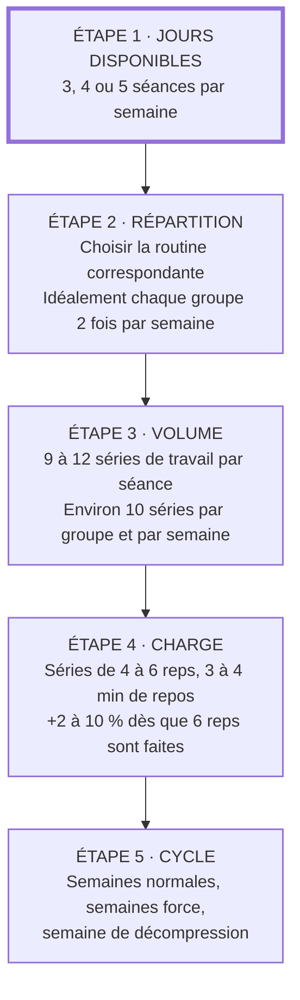

"Il n'existe qu'une seule façon de se doter naturellement d'un capital muscle : faire beaucoup d'exercices composés avec une charge lourde. Et même là, il faut bien deux ans pour prendre 10 à 15 kg de muscle qui permettent à un pratiquant de passer du stade **normal** à celui de **musclé**." (Matthews)

Cette page est pour ceux dont l'objectif est **de devenir fort et de soulever lourd**. Elle part du programme BLS de Michael Matthews (*Plus musclé, plus mince, plus fort*) et le confronte à ce que la recherche établit aujourd'hui. Chaque règle est soit confirmée par une source, soit corrigée quand la littérature la contredit.

La référence principale est la prise de position de l'American College of Sports Medicine publiée en 2026, première mise à jour depuis 2009. Elle synthétise **137 revues systématiques portant sur plus de 30 000 participants** (ACSM 2026).

## Ce que la science établit
### Le plus important : commencer, et durer
Le message central de l'ACSM est que le plus gros bénéfice vient du passage de « aucun entraînement » à « un entraînement régulier », bien plus que de l'optimisation des détails. Les programmes « idéaux » et rigides ne sont plus soutenus par les preuves : le bon programme est celui que l'on suit. Comme le résume Stuart Phillips, qui a présidé le comité : « The best resistance training program is the one you'll actually stick with » (ACSM 2026).

Concrètement, cela veut dire que tout ce qui suit sert à **progresser plus vite**, pas à décider si l'on progresse.

### Le socle minimal
L'Organisation mondiale de la santé recommande à tous les adultes des activités de renforcement musculaire d'intensité modérée ou plus, **sollicitant tous les grands groupes musculaires, au moins 2 jours par semaine** (OMS 2020). L'ACSM retient le même plancher : chaque grand groupe musculaire au moins deux fois par semaine (ACSM 2026).

### Les variables qui comptent
L'ACSM distingue les variables qui pilotent réellement les adaptations de celles dont l'effet est faible ou incohérent.

| Variable | Ce qui est établi | Source |
|---|---|---|
| **Charge** (pour la force) | Travailler autour de **80 % du 1RM ou plus**, 2 à 3 séries par exercice, donne les gains de force maximale les plus nets. | ACSM 2026 ; Schoenfeld 2017 |
| **Charge** (pour le muscle) | Charges lourdes et légères donnent une **hypertrophie similaire** si les séries sont menées près de l'échec. Les charges lourdes restent supérieures pour la force. | Schoenfeld 2017 |
| **Volume** | Relation dose-réponse : plus de séries par semaine, plus de muscle. Viser **environ 10 séries par groupe musculaire et par semaine**. | Schoenfeld 2017b ; ACSM 2026 |
| **Fréquence** | À volume égal, entraîner un muscle une ou plusieurs fois par semaine donne une hypertrophie comparable. La fréquence est surtout un moyen de caser le volume. | Schoenfeld 2019 |
| **Progression** | Augmenter la charge de **2 à 10 %** quand on dépasse d'une ou deux répétitions l'objectif fixé. | ACSM 2009 |

### Les variables qui comptent peu
Pour un adulte en bonne santé, l'ACSM n'a pas trouvé d'effet constant de ces paramètres (ACSM 2026) :

- **Aller jusqu'à l'échec musculaire.** Ce n'est pas nécessaire. Une méta-régression montre que l'hypertrophie augmente quand on finit les séries plus près de l'échec, alors que la force y est presque insensible (Robinson 2024). On peut donc s'arrêter à une ou deux répétitions de l'échec sur les gros mouvements lourds.
- **Machines ou poids libres.** Pas de différence de force ni d'hypertrophie entre les deux en comparaison directe ; chacun progresse un peu plus sur le type de matériel avec lequel il s'entraîne (Haugen 2023). Bandes élastiques et poids du corps donnent aussi des gains mesurables (ACSM 2026).
- **La périodisation.** Les modèles linéaire, ondulatoire ou par blocs donnent des résultats comparables tant que la charge progresse (ACSM 2026).
- **Le tempo.** Des répétitions de 0,5 à 8 secondes donnent une hypertrophie similaire. Seules les répétitions volontairement très lentes (plus de 10 secondes) sont moins efficaces (Schoenfeld 2015).

### Le repos entre les séries
Chez des pratiquants entraînés, 3 minutes de repos donnent plus de force et plus de muscle qu'une minute (Schoenfeld 2016). Une méta-analyse plus récente trouve un léger avantage pour l'hypertrophie au-delà de 60 secondes, et **aucun gain supplémentaire au-delà de 90 secondes** (Singer 2024). Pour du travail lourd, l'ACSM recommandait déjà 3 à 5 minutes entre les séries (ACSM 2009).

Le repos long sert donc surtout à **garder la charge et le nombre de répétitions** d'une série à l'autre.

### Musculation et cardio
Faire du cardio en plus de la musculation **ne freine ni l'hypertrophie ni la force maximale**. Seule la force explosive (sauts, sprints) en pâtit un peu, et surtout quand les deux sont faits dans la même séance ; l'effet disparaît quand on les sépare d'au moins 3 heures (Schumann 2022).

Côté santé, l'OMS recommande en plus du renforcement **150 à 300 minutes d'activité d'endurance modérée par semaine, ou 75 à 150 minutes d'activité intense** (OMS 2020).

### La prévention des blessures
La musculation est l'une des meilleures préventions des blessures sportives : les programmes de renforcement réduisent le risque de blessure à **environ un tiers** de celui des groupes témoins, avec un effet d'autant plus net que le volume est élevé (Lauersen 2018).

### Les protéines
La supplémentation en protéines augmente les gains de masse maigre, mais l'effet plafonne : au-delà d'environ **1,6 g/kg/jour** d'apport total, aucun gain supplémentaire n'a été mesuré (Morton 2018). Le calcul des apports est détaillé dans la page [plan repas](../meal_plan/).

## Fonctionnement d'un programme type BLS
Un programme type BLS repose sur 7 points. Ils sont repris ici avec ce que la recherche en dit :

1. **1 à 2 groupes musculaires chaque jour.** Choix d'organisation, sans effet propre (Schoenfeld 2019).
2. **Des séries de 4 à 6 reps** (pour presque tous les exos). Cela correspond à environ 80-85 % du 1RM, la zone la plus efficace pour la force (ACSM 2026). Pour le muscle, ce n'est pas obligatoire mais ça marche aussi bien qu'une zone plus légère (Schoenfeld 2017).
3. **Faire 9 à 12 séries de travail par séance.** Ce qui compte est le total **par groupe musculaire et par semaine** : vérifier que chaque groupe atteint environ 10 séries (Schoenfeld 2017b).
4. **Un temps de repos de 3-4 min entre les séries.** Confirmé pour du travail lourd (Schoenfeld 2016 ; ACSM 2009).
5. **60-65 minutes d'entraînement.** Conséquence des points 3 et 4.
6. **Chaque groupe musculaire 1 à 2 fois tous les 5 à 7 jours.** Le plancher recommandé est de 2 fois par semaine (OMS 2020 ; ACSM 2026). Une seule fois reste acceptable si le volume hebdomadaire est atteint (Schoenfeld 2019).
7. **Relâcher la pression toutes les 8 à 10 semaines.** Voir la [semaine de décompression](#semaine-de-décompression).

### La progression
Une notion est essentielle : dès que vous effectuez 6 reps sur une série, vous montez en charge sur la série suivante, sans attendre la prochaine séance. L'augmentation standard est de 4 kg (2 kg de chaque côté de la barre). Si après l'augmentation vous bloquez à 2-3 reps, n'augmentez que de 2 kg.

C'est une progression « double » (on gagne des répétitions, puis de la charge), cohérente avec la règle de l'ACSM : **+2 à 10 % quand on dépasse l'objectif d'une ou deux répétitions** (ACSM 2009). Cette fourchette donne un garde-fou pour les petites charges : 4 kg sur un développé couché à 100 kg font 4 %, mais sur un développé militaire à 30 kg ils font 13 %. Dans ce cas, augmenter de 2 kg seulement.

### La cadence
Viser « 2.1.2 » : 2 secondes pour la première partie du mouvement, 1 seconde de pause et 2 secondes pour la dernière partie. Soit environ 5 secondes par répétition, dans la fourchette de 0,5 à 8 secondes où l'hypertrophie est équivalente (Schoenfeld 2015). La cadence sert donc surtout à garder un mouvement contrôlé.

### L'échec
Sur les exercices lourds (squat, soulevé de terre, développés), s'arrêter quand la répétition suivante risquerait d'être ratée. L'échec n'apporte rien de plus pour la force (Robinson 2024) et augmente la fatigue. Sur les exercices d'isolation et les abdos, aller plus près de l'échec est sans risque et favorise l'hypertrophie (Robinson 2024).

## Cardio
Séparer si possible les séances de musculation et de cardio **d'au moins 3 heures** : c'est le seuil au-delà duquel l'interférence sur la force explosive disparaît (Schumann 2022). Si c'est impossible, commencer par la musculation.

Le volume proposé par Matthews :

- En prise de masse : 2 x 25 min de fractionné par semaine.
- En sèche : 3 x 25 min de fractionné par semaine.
- Maintenance : 2 ou 3 x 25 min de fractionné par semaine.

Soit 50 à 75 minutes d'activité intense, ce qui couvre le bas de la recommandation de l'OMS (75 à 150 minutes d'activité intense par semaine, OMS 2020). Matthews ajoute que descendre sous les 10 % de masse graisseuse sera très difficile sans 2-3 séances par semaine.

## Liste des exercices par ordre d'importance pour chaque groupe musculaire
Les exercices polyarticulaires (squat, soulevé de terre, développés, rowings, tractions) sont en tête de liste parce qu'ils sollicitent plusieurs groupes à la fois avec des charges lourdes. Le choix des exercices reste une variable « flexible » que l'on peut adapter à ses préférences et à son matériel (ACSM 2026).

### Pectoraux
1. Développé incliné
2. Développé incliné avec haltères
3. Développé couché
4. Développé couché avec haltères
5. Dip (variantes pectorales)

### Dos
1. Soulevé de terre
2. Rowing à la barre
3. Rowing haltère unilatéral
4. Tractions
5. Tirage poitrine (avant et prise serrée)
6. Rowing barre T
7. Tirage assis à la poulie (prise large et prise serrée)
8. Tractions en supination ou chin-up
9. Haussements d'épaules (ou Shrug) à la barre

### Epaules
1. Développé militaire assis ou développé militaire debout
2. Développé avec haltères assis ou développés Arnold
3. Élévations latérales avec haltères ou élévation latérale à une main
4. Élévations postérieures (incliné ou assis)
5. Face Pull
6. Rowing vertical avec barre
7. Élévations antérieures avec haltères

### Jambes
1. Squat
2. Squat avant
3. Hack Squat (machine, pas à la barre)
4. Presse à cuisses
5. Fentes avec barre (en mouvement ou sur place)
6. Fentes avec haltères
7. Soulevé de terre roumain
8. Leg Curl (allongé ou assis)
9. Élévations mollets (donkey, debout ou assis)
10. Mollets à la presse à cuisses

NB : je fais l'impasse sur des exos spécifiques aux mollets, cela est critiquable.

NB2 : Matthews conseille d'éviter la machine Smith, qui réduirait la prise de muscle. **La recherche ne le confirme pas** : machines et poids libres donnent une hypertrophie et une force comparables (Haugen 2023 ; ACSM 2026). Le squat à la barre libre reste à privilégier si l'objectif est de progresser sur le squat à la barre libre, puisqu'on progresse davantage sur le matériel avec lequel on s'entraîne (Haugen 2023).

### Bras
#### Biceps
1. Curl à la barre
2. Curl à la barre E-Z
3. Curl avec haltères
4. Curl haltères prise marteau
5. Tractions avec prise large

#### Triceps
1. Développé à prise rapprochée
2. Développé triceps assis
3. Dip (variante pour triceps)
4. Extension des triceps couché ("Skullcrusher")
5. Tirages poitrine

### Abdos
1. Crunch à la poulie
2. Relevé de jambes en suspension
3. Relevé de jambes chaine romaine
4. Roue abdominale
5. Pédalage
6. Relevé de jambes étendu
7. Crunch décliné

NB : faire les abdos sous forme de circuits de 3 exos (1 avec charge sur 10 à 12 reps, un jusqu'à l'échec puis encore un jusqu'à l'échec).

## Construire une routine de séance
Voici le chemin, du nombre de jours disponibles au contenu de la séance :

### 5 Jours
1. Pectoraux & abdos
2. Dos et mollets
3. Épaules et abdos
4. Jambes
5. Haut du corps & abdos

### 4 jours
1. Pectoraux & triceps & mollets
2. Dos & biceps & abdos
3. Haut du corps & mollets
4. Cuisses & abdos

### 3 jours
1. Dos & biceps & abdos
2. Pectoraux & triceps
3. Cuisses & épaules

Pour chaque séance, répartir les 9 à 12 séries de travail équitablement entre les groupes musculaires prévus. Faire ensuite le compte sur la semaine : un groupe qui reste nettement sous les 10 séries hebdomadaires (Schoenfeld 2017b) est à renforcer, par exemple dans la séance « Haut du corps ».

Pensez à prévoir un échauffement à chaque début de séance. Réaliser l'intégralité des séries de votre séance en prenant un temps de repos de 3-4 min entre chaque série.

### Echauffement
Avant le premier exercice lourd de la séance, monter progressivement en charge :

- 12 reps à 50 % de la charge de travail
- 1 min de repos
- 10 reps à 50 % de la charge (plus vite)
- 1 min de repos
- 4 reps à 70 % de la charge
- 1 min de repos
- 1 rep à 90 % de la charge
- 2-3 min de repos, puis première série de travail

### Semaine de décompression
#### Jour 1
- Soulevé de terre - 3 séries de 8-10 reps à 50 % de la charge
- Rowing à la barre - 3 séries de 8-10 reps à 50 % de la charge
- Rowing haltère unilatéral - 3 séries de 8-10 reps à 50 % de la charge
- Tractions - 3 séries en poids de corps jusqu'à l'échec

#### Jour 2
- Développé militaire - 3 séries de 8-10 reps à 50 % de la charge
- Développé incliné - 3 séries de 8-10 reps à 50 % de la charge
- Développé couché avec prise rapprochée - 3 séries de 8-10 reps à 50 % de la charge
- Dips - 3 séries en poids de corps jusqu'à l'échec

#### Jour 3
- Squat - 3 séries de 8-10 reps à 50 % de la charge
- Squat avant - 3 séries de 8-10 reps à 50 % de la charge
- Soulevé de terre roumain - 3 séries de 8-10 reps à 50 % de la charge

Ce que l'on sait de la décompression : un consensus d'entraîneurs la définit comme « une période de stress d'entraînement réduit destinée à atténuer la fatigue physiologique et psychologique » (Bell 2023). La seule étude contrôlée disponible montre qu'**une semaine d'arrêt complet** au milieu d'un programme de 9 semaines ne fait perdre aucun muscle, mais pénalise légèrement la force du bas du corps (Coleman 2024). D'où l'intérêt de cette semaine allégée, plutôt qu'un arrêt total.

### Semaine force
#### Semaine force A
##### Jour 1
- Squat : échauffement + 3 séries de travail
- Développé militaire assis ou debout : échauffement + 3 séries de travail
- Soulevé de terre : échauffement + 1 série de travail

##### Jour 2
- Squat : échauffement + 3 séries de travail
- Développé couché : échauffement + 3 séries de travail
- Soulevé de terre : échauffement + 1 série de travail

##### Jour 3
- Squat : échauffement + 3 séries de travail
- Développé militaire assis ou debout : échauffement + 3 séries de travail
- Soulevé de terre : échauffement + 1 série de travail

#### Semaine force B
##### Jour 1
- Squat : échauffement + 3 séries de travail
- Développé militaire assis ou debout : échauffement + 3 séries de travail
- Soulevé de terre : échauffement + 1 série de travail

##### Jour 2
- Squat : échauffement + 3 séries de travail
- Développé militaire assis ou debout : échauffement + 3 séries de travail
- Soulevé de terre : échauffement + 1 série de travail

##### Jour 3
- Squat : échauffement + 3 séries de travail
- Développé couché : échauffement + 3 séries de travail
- Soulevé de terre : échauffement + 1 série de travail

Les 3 séries de travail par exercice correspondent à la recommandation de l'ACSM pour la force : 2 à 3 séries autour de 80 % du 1RM (ACSM 2026).

## Déroulement des séances au global
- 3 semaines séances normales
- 1 semaine Force (A)
- 3 semaines séances normales
- 1 semaine Force (B)
- 1 semaine repos/décompression
- Recommencez.

Ce cycle est une façon d'organiser la progression, pas une obligation : les différents modèles de périodisation donnent des résultats comparables tant que la charge augmente (ACSM 2026). S'il est plus simple pour vous d'enchaîner les semaines normales, la progression de la charge suffit.

## Source
- Michael Matthews, *Plus musclé, plus mince, plus fort*, Talent Sport. C'est la source du programme BLS et de ses règles d'organisation.

- Phillips SM, Currier BS, D'Souza AC, Fiatarone Singh MA, Lowisz CV, Rawson ES, Schoenfeld BJ, Smith-Ryan AE, Steen JP, Thomas GA, Triplett NT, Washington TA, Werner TJ (ACSM 2026), *American College of Sports Medicine Position Stand. Resistance Training Prescription for Muscle Function, Hypertrophy, and Physical Performance in Healthy Adults: An Overview of Reviews*, Medicine & Science in Sports & Exercise, 58(4), p. 851-872, avril 2026 ([doi:10.1249/MSS.0000000000003897](https://doi.org/10.1249/MSS.0000000000003897) ; [communiqué de l'ACSM](https://www.newswise.com/articles/acsm-unveils-landmark-2026-resistance-training-guidelines-first-update-in-17-years)). Synthèse de 137 revues systématiques : fréquence de 2 fois par semaine, environ 80 % du 1RM pour la force, environ 10 séries par groupe et par semaine pour l'hypertrophie, absence d'effet constant de l'échec, du matériel et de la périodisation.

- American College of Sports Medicine (ACSM 2009), *Progression Models in Resistance Training for Healthy Adults*, Medicine & Science in Sports & Exercise, 41(3), p. 687-708, 2009 ([doi:10.1249/MSS.0b013e3181915670](https://doi.org/10.1249/MSS.0b013e3181915670)). Source de la règle de progression de 2 à 10 % et des 3 à 5 minutes de repos pour le travail lourd.

- Bull FC et al. (OMS 2020), *World Health Organization 2020 guidelines on physical activity and sedentary behaviour*, British Journal of Sports Medicine, 54(24), p. 1451-1462, 2020 ([doi:10.1136/bjsports-2020-102955](https://doi.org/10.1136/bjsports-2020-102955)).

- Schoenfeld BJ, Grgic J, Ogborn D, Krieger JW (Schoenfeld 2017), *Strength and Hypertrophy Adaptations Between Low- vs. High-Load Resistance Training: A Systematic Review and Meta-analysis*, Journal of Strength and Conditioning Research, 31(12), p. 3508-3523, 2017 ([doi:10.1519/JSC.0000000000002200](https://doi.org/10.1519/JSC.0000000000002200)).

- Schoenfeld BJ, Ogborn D, Krieger JW (Schoenfeld 2017b), *Dose-response relationship between weekly resistance training volume and increases in muscle mass: A systematic review and meta-analysis*, Journal of Sports Sciences, 35(11), p. 1073-1082, 2017 ([doi:10.1080/02640414.2016.1210197](https://doi.org/10.1080/02640414.2016.1210197)).

- Schoenfeld BJ, Grgic J, Krieger J (Schoenfeld 2019), *How many times per week should a muscle be trained to maximize muscle hypertrophy? A systematic review and meta-analysis of studies examining the effects of resistance training frequency*, Journal of Sports Sciences, 37(11), p. 1286-1295, 2019 ([doi:10.1080/02640414.2018.1555906](https://doi.org/10.1080/02640414.2018.1555906)).

- Schoenfeld BJ, Ogborn DI, Krieger JW (Schoenfeld 2015), *Effect of repetition duration during resistance training on muscle hypertrophy: a systematic review and meta-analysis*, Sports Medicine, 45(4), p. 577-585, 2015 ([doi:10.1007/s40279-015-0304-0](https://doi.org/10.1007/s40279-015-0304-0)).

- Schoenfeld BJ, Pope ZK, Benik FM, Hester GM, Sellers J, Nooner JL, Schnaiter JA, Bond-Williams KE, Carter AS, Ross CL, Just BL, Henselmans M, Krieger JW (Schoenfeld 2016), *Longer Interset Rest Periods Enhance Muscle Strength and Hypertrophy in Resistance-Trained Men*, Journal of Strength and Conditioning Research, 30(7), p. 1805-1812, 2016 ([doi:10.1519/JSC.0000000000001272](https://doi.org/10.1519/JSC.0000000000001272)).

- Singer A, Wolf M, Generoso L, Arias E, Delcastillo K, Echevarria E, Martinez A, Androulakis Korakakis P, Refalo MC, Swinton PA, Schoenfeld BJ (Singer 2024), *Give it a rest: a systematic review with Bayesian meta-analysis on the effect of inter-set rest interval duration on muscle hypertrophy*, Frontiers in Sports and Active Living, 6, 1429789, 2024 ([doi:10.3389/fspor.2024.1429789](https://doi.org/10.3389/fspor.2024.1429789)).

- Robinson ZP, Pelland JC, Remmert JF, Refalo MC, Jukic I, Steele J, Zourdos MC (Robinson 2024), *Exploring the Dose-Response Relationship Between Estimated Resistance Training Proximity to Failure, Strength Gain, and Muscle Hypertrophy: A Series of Meta-Regressions*, Sports Medicine, 54(9), p. 2209-2231, 2024 ([doi:10.1007/s40279-024-02069-2](https://doi.org/10.1007/s40279-024-02069-2)).

- Haugen ME, Vårvik FT, Larsen S, Haugen AS, van den Tillaar R, Bjørnsen T (Haugen 2023), *Effect of free-weight vs. machine-based strength training on maximal strength, hypertrophy and jump performance: a systematic review and meta-analysis*, BMC Sports Science, Medicine and Rehabilitation, 15, 103, 2023 ([doi:10.1186/s13102-023-00713-4](https://doi.org/10.1186/s13102-023-00713-4)).

- Schumann M, Feuerbacher JF, Sünkeler M, Freitag N, Rønnestad BR, Doma K, Lundberg TR (Schumann 2022), *Compatibility of Concurrent Aerobic and Strength Training for Skeletal Muscle Size and Function: An Updated Systematic Review and Meta-Analysis*, Sports Medicine, 52(3), p. 601-612, 2022 ([doi:10.1007/s40279-021-01587-7](https://doi.org/10.1007/s40279-021-01587-7)).

- Lauersen JB, Andersen TE, Andersen LB (Lauersen 2018), *Strength training as superior, dose-dependent and safe prevention of acute and overuse sports injuries: a systematic review, qualitative analysis and meta-analysis*, British Journal of Sports Medicine, 52(24), p. 1557-1563, 2018 ([doi:10.1136/bjsports-2018-099078](https://doi.org/10.1136/bjsports-2018-099078)).

- Morton RW, Murphy KT, McKellar SR, Schoenfeld BJ, Henselmans M, Helms E, Aragon AA, Devries MC, Banfield L, Krieger JW, Phillips SM (Morton 2018), *A systematic review, meta-analysis and meta-regression of the effect of protein supplementation on resistance training-induced gains in muscle mass and strength in healthy adults*, British Journal of Sports Medicine, 52(6), p. 376-384, 2018 ([doi:10.1136/bjsports-2017-097608](https://doi.org/10.1136/bjsports-2017-097608)).

- Bell L, Strafford BW, Coleman M, Androulakis Korakakis P, Nolan D (Bell 2023), *Integrating Deloading into Strength and Physique Sports Training Programmes: An International Delphi Consensus Approach*, Sports Medicine - Open, 9, 87, 2023 ([doi:10.1186/s40798-023-00633-0](https://doi.org/10.1186/s40798-023-00633-0)).

- Coleman M, Burke R, Augustin F, Piñero A, Maldonado J, Fisher JP, Israetel M, Androulakis Korakakis P, Swinton P, Oberlin D, Schoenfeld BJ (Coleman 2024), *Gaining more from doing less? The effects of a one-week deload period during supervised resistance training on muscular adaptations*, PeerJ, 12, e16777, 2024 ([doi:10.7717/peerj.16777](https://doi.org/10.7717/peerj.16777)).
